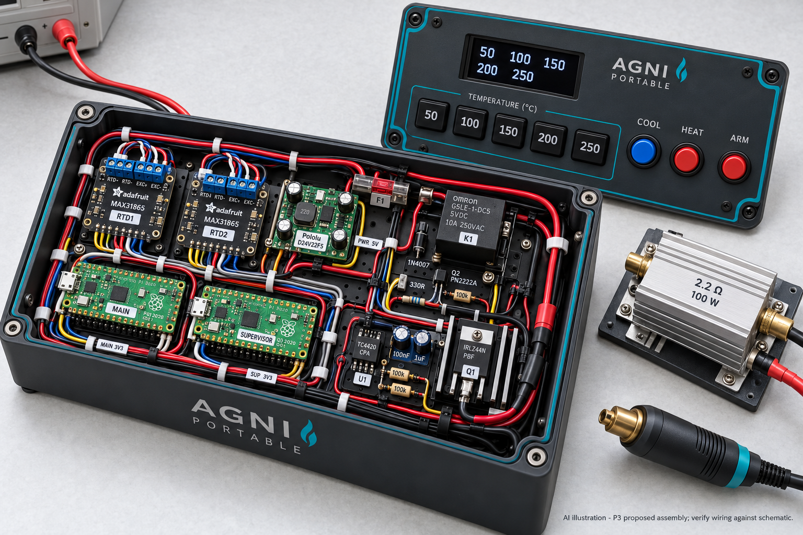
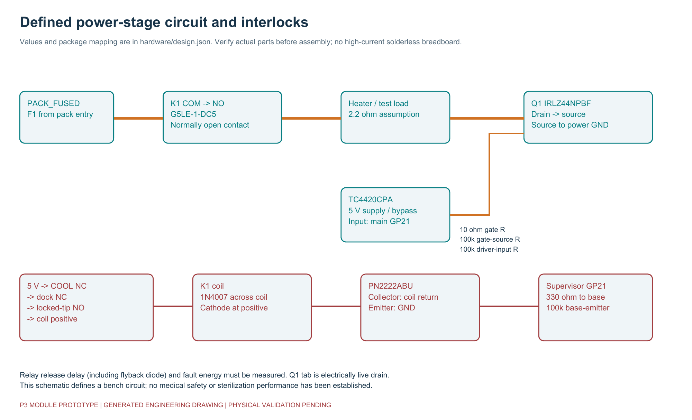
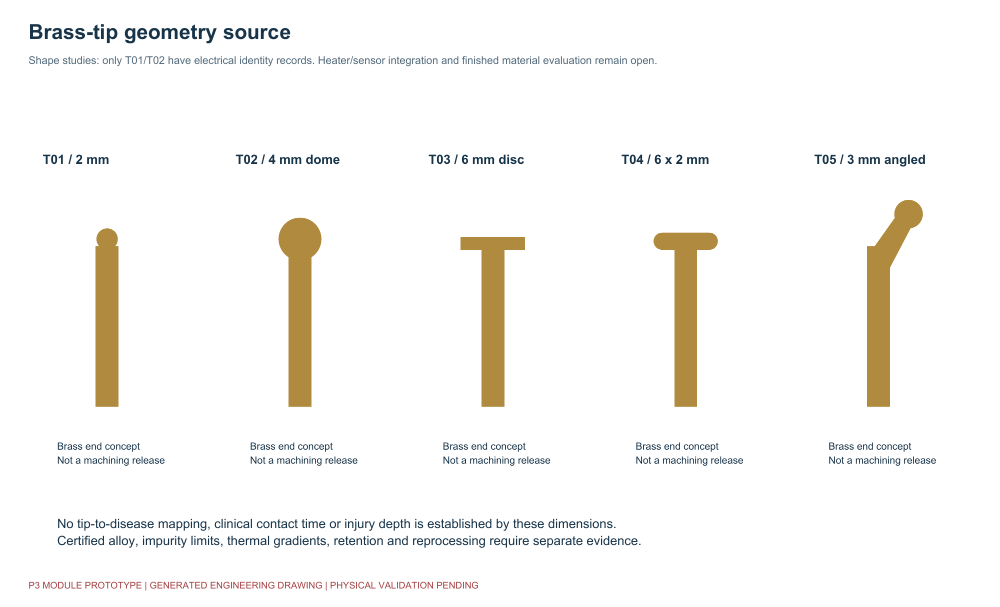

# Agni Karma - integrated prototype build guide

Release 0.5.0, audited 31 October 2026. This is the master navigation and assembly sequence for the five-preset module prototype. It is not a manufacturing release for a patient-use device. See [BUILD_COMPLETENESS.md](BUILD_COMPLETENESS.md) before commissioning work.

## 1. Understand the implementation you are building



The implemented design is a modular, guarded bench controller. It uses two original RP2040 Pico modules, two separate Pt1000 interfaces, a MOSFET PWM stage and a separate relay interruption path. Its temperature selections are **50, 100, 150, 200 and 250 C**. The slim handheld image is a packaging objective; the module set does not fit that image's housing.

The equipment image is AI-generated. Some pictured package geometry and leads differ from real parts. The electrical records, not a visible wire in the image, determine connection. A guarded resistor load is used before any custom hot cartridge is connected.

## 2. Read the minimum design records

| Read first | Purpose |
|---|---|
| [Audit report](AUDIT_REPORT.md) | Actual problems found, corrections and remaining limits |
| [Design JSON](hardware/design.json) | Component references, terminals, nets and assembly notes |
| [Parts list](hardware/BOM.csv) | Electronic items and defined specifications |
| [Pin map](hardware/pinmap.csv) | GPIO versus physical Pico header pin; do not confuse them |
| [Full connections](hardware/component_connections.csv) | Every defined terminal including Pico GPIO and sensor leads |
| [Net schedule](hardware/net_schedule.csv) | All terminals sharing each electrical net |
| [Procurement checklist](hardware/procurement_checklist.csv) | Revision checks, supplier decisions and unresolved purchases |
| [Electrical guide](docs/electrical.md) | Power, returns, interlocks, ADC and interface rules |

Two output pins marked 3V3_OUT belong to two separate Pico regulators. Do not connect those two outputs together. They have a common ground, but each powers its own sensor interface and measurement branches. Physical insulation, current return and unpowered backfeeding require review.

## 3. Complete engineering decisions before ordering

Confirm purchased module revisions and pinouts. In particular, the interface must be the Pt1000 MAX31865 variant with the intended reference resistor, the driver must be the non-inverting TC4420 variant, and the PN2222ABU pin arrangement must match the drawing. Similar part names are not a safe substitution rule.

The current OLED specification is the Adafruit 326 STEMMA QT revision with automatic reset. Older reset-dependent variants need a different circuit and are not approved by this wiring record. Confirm I2C mode and address before upload.

The final protected battery pack, matching charger, cartridge heater construction, connector, temperature sensor package and brass process have not been qualified. Do not interpret a generic item in the BOM as a completed supplier qualification. Track those decisions in the procurement checklist.

## 4. Prepare the low-current assembly

Keep heater and battery disconnected. Follow [the routed carrier assembly sequence](docs/pcb.md) and [fabrication review instructions](hardware/fabrication/P3R1/README.md) if using the new PCB. It is only a low-current breakout: the other circuit components remain external. The connector CSV is authoritative for breakout versus Pico pin numbering. Mount modules securely on an insulated fixture. Wire the two controllers to the regulated logic supply, preserving separate 3V3 outputs. Check polarity and absence of shorts with the supply off.

Each controller has its own SPI0 connection: GP6 clock, GP7 MOSI, GP4 MISO and GP5 chip select. MAIN and SUPERVISOR do not share one MAX31865. Each MAX31865 connects to its own four-wire Pt1000 element. The two wires at one element end go to force-plus and sense-plus; the two at the other end go to sense-minus and force-minus. Identify the real sensor leads with its supplier documentation; do not infer them solely from colour.

The UART TX/RX lines cross between controllers through the specified branch resistors. Each controller's health pulse goes to the other controller's health input. Use the pin map for exact physical header locations. Interface GPIO is 3.3 V; do not connect a 5 V signal to it.

Wire the five preset buttons, HEAT, ARM, COOL, dock and tip-presence circuits. The shared switches branch through individual resistors to each Pico. The physical COOL circuit has a separate contact in the relay-coil power chain; firmware input alone is insufficient for this architecture.

## 5. Prepare firmware and configuration

From the repository root:

```sh
python tools/verify.py
python -m tools.deploy main
python -m tools.deploy supervisor
```

Install the official MicroPython runtime for an original RP2040 Pico, then copy each generated role folder's contents to the corresponding board root. The firmware package directory must stay intact. The generated root main.py selects the role.

New provisioning records disable heat. A nonempty calibration-record identifier is required along with valid role, numeric corrections, reference value and display address. The identifier itself does not prove calibration. Keep actual measured records and do not enable a bench output merely to make the screen look operational.

Deployment now preserves an existing local provision.json. `--reset-provision` deliberately replaces it with disabled defaults. Review the upload directory before copying it to a board.

## 6. Check the low-current system

Verify rails and GPIO voltages with an appropriate current-limited supply. Verify the display, both sensor conversions, fault detection, all buttons, role identity, UART directions and health pulses. Startup, missing provisioning, invalid measurements and exceptions must leave outputs inactive.

Use calibrated resistance standards for initial RTD electronics checks. A resistance test validates electrical conversion, not working-face temperature or thermal lag. The four-wire sensor assembly must later be compared against an independent thermal reference in the actual cartridge.

Press/release sequences matter. Release ARM and HEAT after boot. Select one preset long enough to debounce; wait for target agreement. Press ARM with HEAT released, then hold HEAT to request power. The main armed permit and the supervisor's own checks must both be present for the relay output. COOL, a fault or a setting change requires re-arming after valid conditions return.

## 7. Assemble the guarded power stage



[Detailed terminal wiring](docs/images/terminal-wiring.svg) is generated from the design records.

The power path is fused low-voltage positive -> relay COM/NO -> test load -> MOSFET drain/source -> power return. Neither heater supply current nor its return should flow through Pico or sensor-module wiring. Do not carry this current on a solderless breadboard.

The TC4420 drives the MOSFET gate at 5 V through the specified gate resistor. Gate and driver-input pull-downs give inactive defaults. Driver bypass capacitors belong near its supply pins. The MOSFET tab is connected to drain and must not become an unintended exposed conductor or shared chassis connection.

The supervisor drives the relay-coil transistor. The coil's positive supply passes through COOL, dock and locked-tip contacts. Check flyback-diode polarity. Relay release delay depends on suppression, hardware and operating conditions and has not been measured here. A welded relay contact remains a fault case requiring engineering evaluation.

Use a resistor load rated for the actual continuous dissipation and its specified heat sink. A part printed '2.2 ohm' without an adequate thermal rating is not enough. Prepare a guarded fixture and independent power isolation before applying load current.

## 8. Characterize the real system

Record output waveforms, rail behaviour, current, switching temperatures and stop times. Execute approved fault fixtures for lost communication, sensor open/short/detachment, stuck controls, interlock failure and power-switch faults. Do not improvise uncontrolled battery shorts as a test.

The present software uses provisional timing, gains and thermal margins. It estimates available heater power from voltage and nominal resistance; it does not measure actual heater current. Correct operation of the mathematical bound cannot detect every partial heater short. Record that limitation in the risk analysis.

The source tests use simulated hardware interfaces. No target-board execution or physical thermal performance is established by this release. Follow the [physical test plan](docs/testing.md) and record actual results rather than converting host test results into hardware pass marks.

## 9. Develop the brass cartridge and portable configuration



Use the [cartridge specification](docs/cartridge-specification.md) to commission a supplier-qualified heater/sensor assembly. Required work includes exact alloy/impurity limits, insulation, joining/sealing materials, dual-sensor retention, hot/cold resistance, surface finish, positive locking, traceability and reprocessing compatibility.

The OpenSCAD files now include native closed STL exports and a carrier-aligned controller enclosure with mounts, lid and clamp. Physical fit and material performance are untested. They remain prototype shape/enclosure models. They do not provide released tolerances, sensor/heater pockets, qualified seals or a manufactured lock. T01/T02 have electrical identity codes; T03-T05 remain unsupported development geometries. No disease or contact-time claim is assigned to them.

A portable build needs a qualified protected pack and matched charger, measured heat soak, wiring/fuse coordination, charging interlock and mechanical protection. The bench project is not a complete charger design. COOL removes input heat; it cannot instantly remove stored heat from brass. Active fan cooling is not implemented in this version.

## 10. Release and sharing

Run the verification and source-package tools. Inspect the SHA-256 manifest and package contents. The ZIP excludes build files, local provisioning and common secret/key file names, but the owner still needs to review content before public upload.

Review the [engineering handover](docs/engineering-handover.md), [native CAD records](docs/records/native-cad-checks.json) and [mesh records](docs/records/mechanical-checks.json). For GitHub upload use [docs/github.md](docs/github.md), preserving `.github/` and the directory structure. Licensing remains the owner's decision. Public visibility does not license reuse or establish product approval.

The remaining manufacturing and clinical gates are listed in [BUILD_COMPLETENESS.md](BUILD_COMPLETENESS.md). This guide is detailed enough to organize and review the module prototype; it does not replace the engineering measurements needed to release a full medical device.
