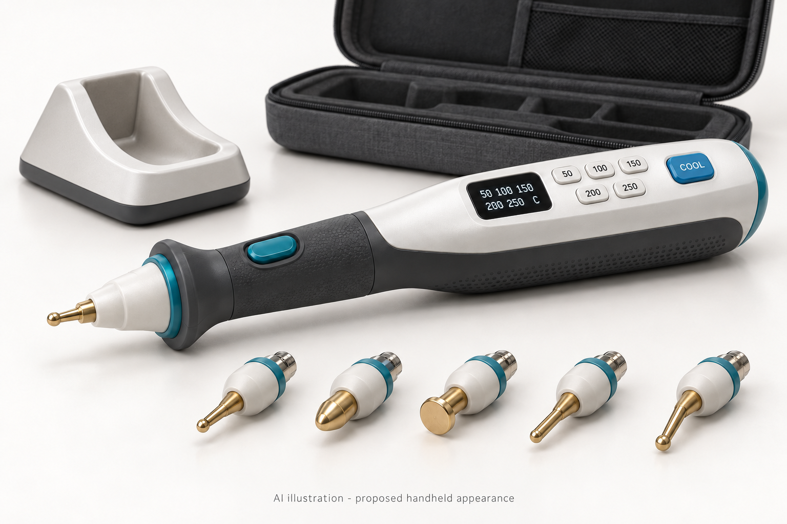
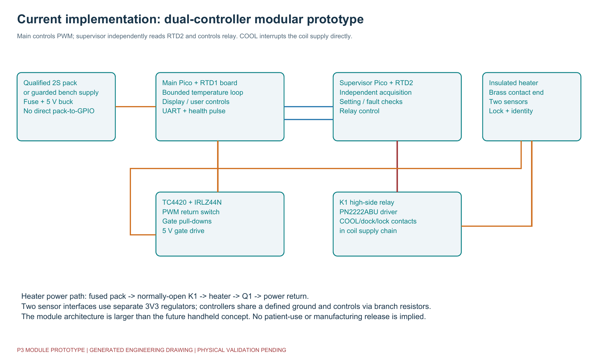
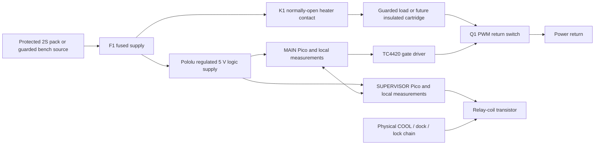
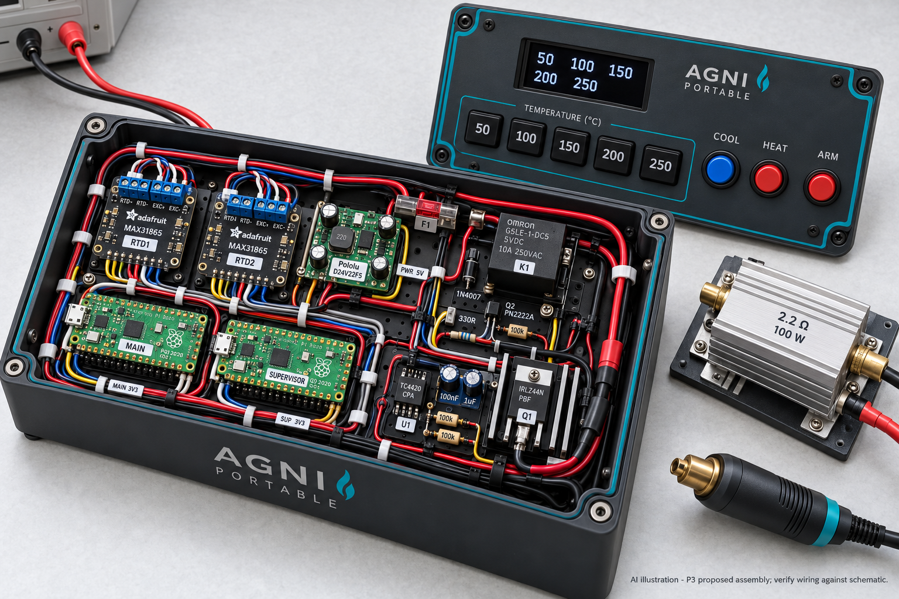
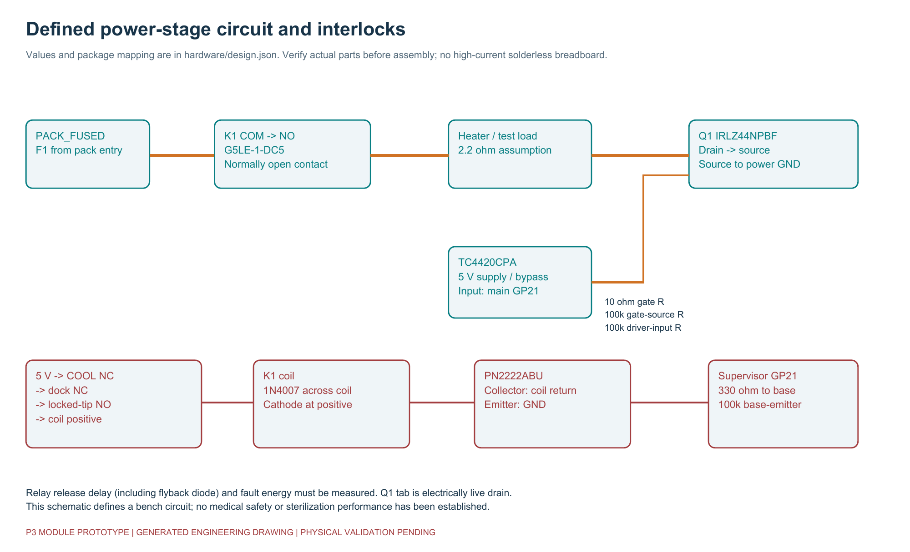
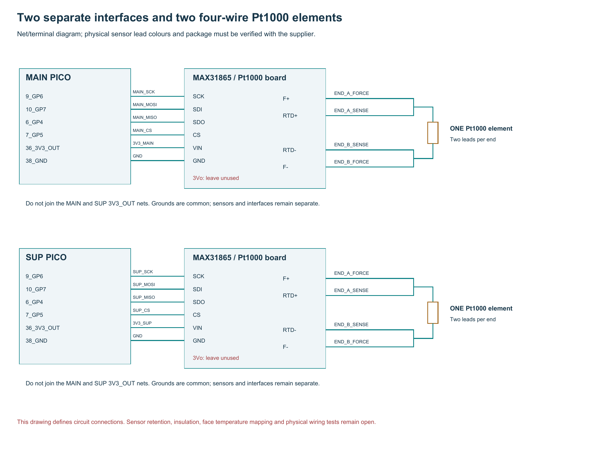
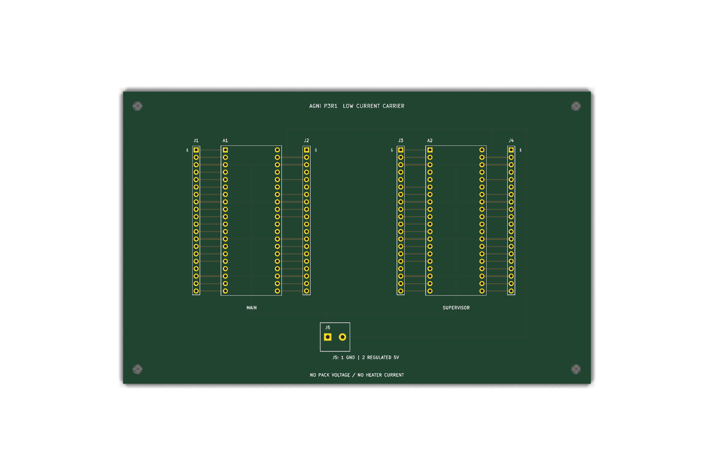
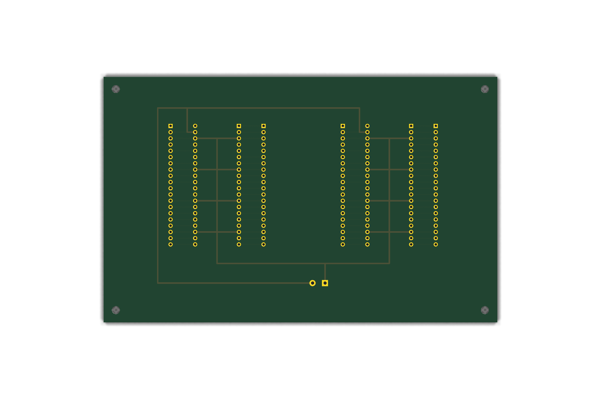
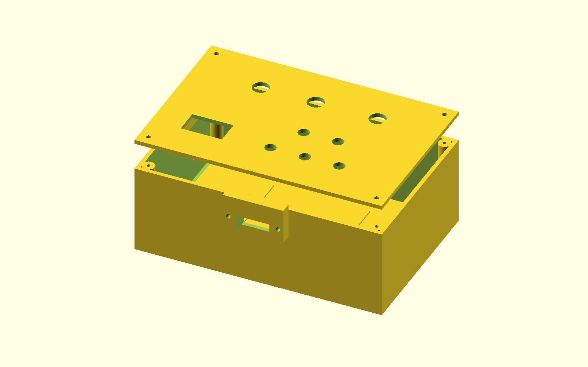
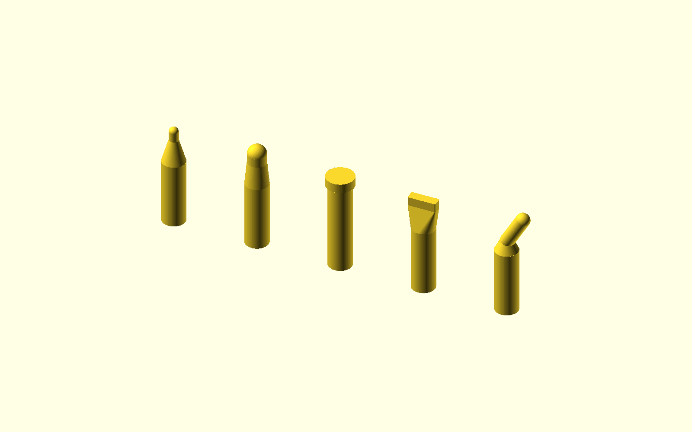

# Agni Karma Portable

**Five-preset thermal-applicator engineering project — P3R1, release 0.5.0.**

The intended product is a portable, battery-powered applicator with **50 / 100 / 150 / 200 / 250 degrees Celsius**, one interchangeable brass tip at a time, simple controls and a dedicated COOL button. This repository contains the current prototype software, electrical definition, routed controller carrier, mechanical source, engineering calculations and verification records.

**Current status:** the implemented design is a guarded modular bench prototype. It has not been manufactured, run on physical Pico boards or validated for patient use. The compact handheld housing, complete heated cartridge, qualified battery/charger and medical release are unfinished. The [build-completeness assessment](BUILD_COMPLETENESS.md) identifies those gaps. This README explains both the supplied implementation and the work needed to develop it further.



*AI-generated appearance illustration of the intended handheld product. Its housing is not the enclosure supplied for the current modular electronics. Rendered screens and wires are illustrations, not measured equipment or wiring instructions.*

## Contents

- [Project scope and current status](#project-scope-and-current-status)
- [Start here and document authority](#start-here-and-document-authority)
- [Functional requirements and user controls](#functional-requirements-and-user-controls)
- [System architecture and illustrations](#system-architecture-and-illustrations)
- [Repository layout and deliverables](#repository-layout-and-deliverables)
- [Parts list and procurement](#parts-list-and-procurement)
- [Power distribution and electrical boundaries](#power-distribution-and-electrical-boundaries)
- [Heater switching and relay circuit](#heater-switching-and-relay-circuit)
- [Controls and physical interlocks](#controls-and-physical-interlocks)
- [Temperature sensing and analog monitoring](#temperature-sensing-and-analog-monitoring)
- [Pico GPIO and physical header map](#pico-gpio-and-physical-header-map)
- [Routed PCB and fabrication files](#routed-pcb-and-fabrication-files)
- [Mechanical assembly and brass contact ends](#mechanical-assembly-and-brass-contact-ends)
- [Heater material and power calculations](#heater-material-and-power-calculations)
- [Battery charging and COOL behaviour](#battery-charging-and-cool-behaviour)
- [Computer setup and source verification](#computer-setup-and-source-verification)
- [Firmware deployment and commissioning records](#firmware-deployment-and-commissioning-records)
- [Operating sequence and software states](#operating-sequence-and-software-states)
- [Firmware limits protocol and failure boundaries](#firmware-limits-protocol-and-failure-boundaries)
- [Bench build sequence and inspection gates](#bench-build-sequence-and-inspection-gates)
- [Calibration and measurement records](#calibration-and-measurement-records)
- [Verification results and evidence limits](#verification-results-and-evidence-limits)
- [Troubleshooting and recovery](#troubleshooting-and-recovery)
- [Reproducing diagrams CAD and calculations](#reproducing-diagrams-cad-and-calculations)
- [Packaging GitHub and repository maintenance](#packaging-github-and-repository-maintenance)
- [Remaining engineering and medical release work](#remaining-engineering-and-medical-release-work)
- [Research sources and image provenance](#research-sources-and-image-provenance)
- [Appendix full system bill of materials](#appendix-full-system-bill-of-materials)
- [Appendix complete carrier connector table](#appendix-complete-carrier-connector-table)
- [Appendix all component terminal connections](#appendix-all-component-terminal-connections)

## Project scope and current status

The project has three distinct physical subjects: the **controller assembly**, the **external guarded power/sensor fixture**, and the **future interchangeable heated cartridge**. Understanding their boundaries is necessary before ordering or connecting parts.

| Subject | Supplied in this release | Development still required |
|---|---|---|
| Control software | Actual MicroPython applications for MAIN and SUPERVISOR, drivers, provisioning, host tests and simulation | Target execution, measured timing, hardware fault tests and software release validation |
| Electrical definition | Named components, values, full terminal connections, GPIO map and full-system schematic | Independent circuit/package review and physical electrical, thermal and fault measurements |
| Controller PCB | Routed 160 x 100 mm two-layer low-current carrier, matched schematic, local libraries and native reports | Independent CAM and purchased-part fit review, fabrication, assembly and continuity testing |
| Fabrication candidates | Six Gerber layers, separate plated/non-plated drills, maps and job file | Fabricator/assembler review and approval before ordering |
| Controller enclosure | Parametric 180 x 120 x 65 mm base, lid, mounts and harness cover; compiled meshes | Exact switch/display adapter fit, material, strength, wiring clearance and thermal testing |
| Brass contact ends | Five nominal shape models; T01/T02 electrical identity codes | Controlled material/process/tolerances and complete cartridge construction; T03–T05 software support |
| Heating cartridge | Functional supplier specification and resistance-wire calculations | Actual heater, ceramic, insulation, joints, dual sensors, lock, seals and supplier/finished-device testing |
| Portable power | Protected 2S architecture and monitoring circuits | Exact pack and matching charger, charging lockout, protection coordination, transport and heat-soak tests |
| Cooling | Physical relay-coil interruption and latched software cooling/inhibition | Measured cooldown and safe-handling criteria; active cooling if separately designed |
| Medical release | Risk, traceability, testing and handover documents | Intended use/market decisions, quality work, electrical/EMC, biological, reprocessing, usability and clinical/regulatory evidence |

The carrier is a **Pico breakout board**. It does not contain the external gate driver, power MOSFET, relay, branch resistors, sensor boards, ADC protection or battery charger. A populated carrier alone is not the complete controller circuit.

The AI illustrations, native CAD renders, calculation worksheets, host tests and physical-test forms have different evidentiary roles. A blank test form is a plan; a native rendering is a geometric view; a passing host test is a software result. None is a photograph or physical performance measurement.

## Start here and document authority

Use this README as the overview and detailed navigation guide. When making a connection, use the machine-readable terminal records and the applicable manufacturer drawing together.

| File | What it defines |
|---|---|
| [START_HERE.md](START_HERE.md) | Entry points and current project scope |
| [BUILD_GUIDE.md](BUILD_GUIDE.md) | Integrated prototype assembly sequence |
| [hardware/design.json](hardware/design.json) | Component references, terminal names, nets and notes |
| [hardware/BOM.csv](hardware/BOM.csv) | Full system component list, values and assembly notes |
| [hardware/component_connections.csv](hardware/component_connections.csv) | Every defined component terminal and its net |
| [hardware/pinmap.csv](hardware/pinmap.csv) | Pico GPIO number versus physical header pin |
| [hardware/net_schedule.csv](hardware/net_schedule.csv) | All terminals joined by each net name |
| [hardware/carrier_connectors.csv](hardware/carrier_connectors.csv) | Breakout connector pin versus Pico physical pin |
| [hardware/carrier_BOM.csv](hardware/carrier_BOM.csv) | Carrier board, sockets, headers, inlet and proposed fasteners |
| [hardware/procurement_checklist.csv](hardware/procurement_checklist.csv) | Purchased revisions, supplier decisions and evidence still needed |
| [AUDIT_REPORT.md](AUDIT_REPORT.md) | Corrected findings and current limitations |
| [BUILD_COMPLETENESS.md](BUILD_COMPLETENESS.md) | Remaining manufacturing and medical release gates |
| [docs/engineering-handover.md](docs/engineering-handover.md) | Instructions for an engineer, cartridge supplier and subsequent development |

In the connection records, identical non-NC net names mean electrical continuity. Names beginning with `NC_` identify terminals that remain unconnected. Do not join all NC terminals into a common circuit.

A module terminal such as `VIN`, `SDI`, `COM` or `COIL_A` is a functional terminal name. It does not automatically specify a numbered leg on the internal IC or relay package. Identify real package legs from the exact purchased part's manufacturer drawing. GPIO `GP21`, Pico physical pin `27` and carrier connector numbering are three different labels for related locations; do not interchange the numbers.

## Functional requirements and user controls

| Function | Current behaviour |
|---|---|
| Temperature selection | Five momentary buttons: **50, 100, 150, 200 and 250 C**; 300 C is not selectable |
| Startup | MAIN defaults to a 50 C target but remains locked with output inhibited |
| Tip connection | One positively locked, identified tip at a time; T01/T02 codes are recognized |
| ARM | A deliberate release followed by a new press, while HEAT is released, requests arming when checks are healthy |
| HEAT | Must be held to request heater energy; releasing it removes the output request |
| COOL | Interrupts the relay-coil supply through one physical switch pole and sends a logic request through the other |
| After COOL | Output stays inhibited; releasing COOL does not restart heating; valid conditions and a new ARM sequence are required |
| Setting change/fault | Disarms the controller; healthy readings alone do not restore heating |
| Docked condition | Physical coil interruption and logic inhibition |
| Tip removal/unlock | Opens the intended physical interlock and removes the logic permit |
| Display | MAIN shows state, selected setpoint, measured tip temperature, pack voltage and fault/status text |
| Temperature disagreement | Each controller checks its local sensor against the peer temperature |
| Communications loss | Stale UART or missing health pulses withdraw the software permit |

The five numbers are the available **setpoints**. The firmware also displays actual temperature and fault information. The illustrated five-value selection screen is not a literal capture of the running display.

Selection is shared through individual resistor branches to both boards. Firmware rejects a multiple-key condition. Press one selection button deliberately and allow both controllers to agree before arming; the operating procedure uses a press of at least 200 ms. This is a bench interaction procedure, not a clinical treatment protocol.

## System architecture and illustrations



MAIN reads its Pt1000 sensor, user inputs and monitoring circuits, runs the bounded temperature loop, updates the OLED and drives the PWM gate-driver input. SUPERVISOR reads a separate Pt1000 channel and its own monitoring/input branches, checks MAIN's status and controls the relay-coil transistor. MAIN also requires a healthy supervisor permit before delivering PWM.

The two controllers exchange CRC-protected UART frames and separate toggling health-pulse signals. A pulse is emitted after a completed acquisition/control/transmit iteration. Two boards improve monitoring options, but common software, runtime, supply, switches and ground remain common-cause failure paths requiring assessment.



The Mermaid drawing is functional. Use the terminal records and detailed drawings for actual contact/driver wiring.



*AI-generated bench-equipment illustration constrained to the specified equipment families. Individual leads and package geometry are approximate. The current native PCB and enclosure views below show supplied CAD; neither image proves assembly or wiring.*

## Repository layout and deliverables

```text
agni karma/
  README.md                    Detailed project guide
  START_HERE.md                Entry points
  BUILD_GUIDE.md               Integrated assembly sequence
  BUILD_COMPLETENESS.md        Open release gates
  AUDIT_REPORT.md              Source corrections and current findings
  SOURCE_MANIFEST.json         SHA-256 inventory of delivered source files
  firmware/
    app.py                     RP2040 hardware adapter and loop
    core.py                    Controllers, samples, fault logic and link protocol
    config.py                  Pins, five presets and provisional bench limits
    provision.py               Configuration validation
    provision.example.json     Disabled example commissioning record
    boot_main.py               MAIN role entry point
    boot_supervisor.py         SUPERVISOR role entry point
    drivers/                   MAX31865 and OLED drivers
  hardware/
    BOM.csv                    Full system BOM
    design.json                Machine-readable electrical definition
    component_connections.csv  Component-terminal-to-net data
    pinmap.csv                 GPIO and Pico physical header map
    net_schedule.csv           Connections grouped by net
    carrier_BOM.csv            Carrier assembly items
    carrier_connectors.csv     All four breakout headers
    procurement_checklist.csv  Supplier and qualification decisions
    calculations/              Power, drive, divider and resistance-wire worksheets
    kicad/                     Native projects, schematics, board and local libraries
    drawings/                  Native schematic/layer PDFs and exported netlist
    fabrication/P3R1/          Candidate Gerbers, drills, maps and instructions
  mechanical/
    bench_enclosure.scad       Controller base, lid, mounts and harness cover
    tips.scad                  Five nominal brass contact-end shapes
    assembly_parameters.json   Dimensions, locations and fit boundaries
    exports/                   Eight STL meshes and board-only STEP
  docs/
    images/                    AI illustrations, native renders and engineering drawings
    records/                   Actual check results and blank measurement forms
    ...                        Electrical, firmware, mechanical, test and handover guides
  tests/                       Host/integration/design/tooling checks
  tools/                       Verification, deployment, generation and packaging
  .github/                     CI workflow and issue/PR templates
```

`build/`, Python caches, local provisioning, editor caches and release ZIPs are generated/local material. They are excluded from the distributable source package. The cleaned project folder contains the current files and manifest; release archives are stored separately.

## Parts list and procurement

The full system contains **78 defined component references**. A reference is a design item, not proof that an exact supplier SKU, purchased revision or final cartridge has been qualified. Full values and notes appear in the BOM appendix below.

| Subsystem | Defined part or specification | Procurement consideration |
|---|---|---|
| MAIN/SUPERVISOR | Two original Raspberry Pi Pico RP2040 boards | Confirm purchased revision, header orientation and target runtime |
| RTD interfaces | Two Adafruit **3648** Pt1000 MAX31865 breakouts | 4.3 kohm reference version; a Pt100 board is not equivalent |
| Temperature elements | Two separate four-wire Pt1000 assemblies, alpha 0.00385 family | Actual package, leads, retention and insulation remain supplier work |
| Logic regulator | Pololu **2858 / D24V22F5** | Regulated 5 V to VSYS; review input/thermal conditions |
| Gate driver | **TC4420CPA**, non-inverting, PDIP-8 | TC4429 inverting variant is not a direct substitute |
| PWM switch | Infineon **IRLZ44NPBF**, TO-220 | Verify gate drive, dissipation, mounting and live drain tab |
| Heater relay | Omron **G5LE-1-DC5** | Normally-open contact; not a certified redundant safety relay |
| Relay transistor | onsemi **PN2222ABU**, TO-92 | Exact package pinout matters; similarly named variants can differ |
| Flyback diode | **1N4007** | Polarity across coil; suppression affects release time |
| Display | Adafruit **326**, STEMMA QT auto-reset SSD1306 revision | I2C mode/address and actual adapter fit must be checked |
| Commissioning load | **2.2 ohm, at least 100 W chassis resistor**, on its specified heat sink | Continuous rating depends on mounting/heat sink; not a medical tip |
| Initial fuse proposal | **5 A**, with suitable DC-rated holder | Final interrupt rating and curve/wire/pack coordination remain open |
| Controls | Five NO preset buttons, ARM, HEAT, DPDT COOL, two-pole dock/lock switches | Exact parts/contact ratings and fit need selection |
| Portable source | Protected **2S** battery pack and matched charger | Exact models, charge lockout and system qualification are open |

Carrier-only components and proposed fasteners are separately defined:

| Reference | Quantity | Specification | Use or review |
|---|---|---|---|
| `PCB_CARRIER` | 1 | AGNI P3R1; 160 x 100 mm; 2-layer FR4; nominal 1.6 mm; 35 um copper; mask both sides; top silkscreen | Fabrication candidate only; independent CAM and physical footprint review before order |
| `A1/A2 sockets` | 4 | 1x20 female socket strip; 2.54 mm pitch; 0.64 mm square-pin compatible; straight through-hole; 1.0 mm PCB drill | Two strips per Pico; choose matched stack height; verify orientation and engagement |
| `J1/J2/J3/J4` | 4 | 1x20 straight male header; 2.54 mm pitch; 0.64 mm square posts; 1.0 mm drill | Low-current external breakouts; external 1k branches and all other circuits still required |
| `J5` | 1 | Phoenix Contact 1715721 MKDS 1.5/2-5.08; 2-position; 5.08 mm pitch; 1.3 mm drill | Pin 1 GND; pin 2 regulated 5 V only; confirm actual footprint and torque against current supplier drawing |
| `Carrier screws` | 4 | M3 x 6 pan head; insulating washers as needed | Fit model pilot posts; check protrusion and engagement |
| `Lid screws` | 4 | M3 x 10 pan head | Fit model pilot posts; qualify repeated use |
| `Clamp screws` | 2 | M3 x 10 pan head with washers | Check cable retention; insulating grommet required |

Do not add carrier sockets/headers to the full system twice when preparing a purchase order. The two Pico modules are already system items; socket strips support those modules. Module-internal ICs/passives remain manufacturer-controlled components rather than a guessed replacement circuit in this repository.

Record supplier, exact part revision, evidence identifier and substitutions in [procurement_checklist.csv](hardware/procurement_checklist.csv). Wire gauge, high-current connector, final fuse, battery, charger, precise sensor package, switches and complete cartridge must be resolved before treating procurement as finished. No current prices, supplier quotations or total product cost are established here.

## Power distribution and electrical boundaries

The nominal heating branch and regulated logic branch share the defined return but have different current paths:

```text
Source positive -> F1 -> PACK_FUSED -> K1 COM
K1 NO -> HEAT_PLUS -> guarded load/heater -> HEAT_MINUS -> Q1 drain
Q1 source -> dedicated power return -> source negative

PACK_FUSED -> Pololu VIN
Pololu VOUT 5 V -> carrier J5 pin 2 -> Pico VSYS, driver and coil circuit
Power/logic GND -> carrier J5 pin 1 and the defined circuit return

MAIN 3V3_OUT -> MAIN RTD interface and MAIN measurement pull-ups
SUP  3V3_OUT -> SUP  RTD interface and SUP  measurement pull-ups
```

The two Pico **3V3_OUT** pins are separate regulator outputs. Keep `3V3_MAIN` and `3V3_SUP` separate. `5V` is regulated logic power; `PACK_FUSED` is the fused battery/bench input. Never substitute one for the other at the Pico, GPIO, ADC or carrier inlet.

Do not route heater current through the carrier headers, sensor-module ground leads or a solderless breadboard. Use mechanically retained, appropriately rated power terminals/harnesses and a controlled return arrangement. Review layout, conductor/insulation ratings, loop area, supply transients and grounding against measured currents. A nominal fuse value alone does not settle these questions.

Keep USB disconnected during powered heater tests unless the combined USB/bench/battery supply and grounding arrangement has been reviewed. USB can introduce another return or source path; it is not medical isolation. The passive carrier has no reverse-polarity protection.

Start commissioning with an instrumented current-limited bench supply and disconnected heater. A portable pack is a later integration step; it is not automatically qualified by using a protected cell assembly.

## Heater switching and relay circuit



[Detailed terminal wiring PNG](docs/images/terminal-wiring.png) · [editable terminal wiring SVG](docs/images/terminal-wiring.svg) · [full-system schematic PDF](hardware/drawings/module-system-schematic.pdf)

### Main PWM path

MAIN `GP21` drives `PWM_INPUT`. U1 is the non-inverting TC4420CPA powered from regulated 5 V. Its duplicated output pins join `DRIVE`; the 10 ohm resistor connects DRIVE to Q1 gate. Q1 switches the heater return at the configured 1 kHz PWM frequency.

| Part / terminal | Defined connection |
|---|---|
| U1 pins 1 and 8 | Regulated `5V` |
| U1 pin 2 | `PWM_INPUT` from MAIN GP21 |
| U1 pin 3 | Unconnected (`NC_U1_3`) |
| U1 pins 4 and 5 | `GND` |
| U1 pins 6 and 7 | Joined as `DRIVE` |
| R1, 10 ohm | DRIVE to Q1 gate (`MOS_GATE`) |
| R2, 100k | Q1 gate to source/GND |
| R3, 100k | Driver input to GND |
| C1, 100 nF / 25 V X7R | Driver 5 V bypass to GND |
| C2, 1 uF / 25 V X7R | Driver 5 V bypass to GND |
| C3, 100 uF / 16 V low ESR | Positive to 5 V, negative to GND |
| Q1 pin 1 | Gate |
| Q1 pin 2 and tab | Drain / `HEAT_MINUS` |
| Q1 pin 3 | Source / power GND |

The package/duplicate-pin reference is the [Microchip TC4420/TC4429 datasheet](https://ww1.microchip.com/downloads/en/DeviceDoc/21419D.pdf). Keep bypass loops short at the driver. The Q1 tab is electrically live drain, so a heat sink, screw or chassis contact must not create an unintended connection. Actual switching waveform, gate behaviour, losses and surface temperatures must be measured.

### Supervisor relay path

K1 COM receives `PACK_FUSED`; its normally-open contact supplies `HEAT_PLUS`. Its unused normally-closed contact stays unconnected. The coil circuit is separate from those power contacts.

```text
5V -> COOL pole A COM/NC -> dock pole A COM/NC
   -> locked-tip pole A COM/NO -> K1 COIL_A
K1 COIL_B -> Q2 collector
Q2 emitter -> GND
SUPERVISOR GP21 -> R4 330 ohm -> Q2 base
Q2 base -> R5 100k -> GND
D1 cathode -> COIL_A; D1 anode -> COIL_B
```

For the specified PN2222ABU record, terminals are **1 emitter, 2 base, 3 collector**. Verify the actual manufacturer's drawing and package before soldering. The repository uses Omron coil/COM/NO functional names; identify the real relay legs from its exact package drawing rather than assuming those names are pin numbers.

Opening COOL, docking or unlocking/removing the cartridge interrupts the intended coil chain. A welded relay contact or shorted MOSFET is a separate fault scenario; the circuit has not been certified to tolerate those faults. A flyback diode protects the coil switch but changes release timing. Measure relay release and resulting energy instead of treating the software timeout as the physical stop time.

## Controls and physical interlocks

Each shared logic switch connects a bus to GND when active. Each controller reaches that bus through its **own 1k branch resistor**, using its own internal input pull-up. This shares the switch action without joining the two 3V3 regulator outputs.

For an ordinary preset, the path is `MAIN GPIO -> MAIN 1k -> switch bus`, `SUP GPIO -> SUP 1k -> same bus`, then the NO switch to GND. ARM and HEAT use the same branching principle. The full terminal appendix contains their actual reference/net names.

| Interlock | Physical pole A | Logic pole B | Meaning when actuated |
|---|---|---|---|
| COOL | COM to NC is in the coil supply path | COM GND to NO `COOL_LOGIC` | Coil supply opens and both controllers read COOL active |
| Dock | COM to NC is in the coil supply path | COM GND to NO `DOCK_LOGIC` | Coil supply opens and both controllers read docked |
| Tip lock | COM to NO is in the coil supply path | COM GND to NO `TIP_PRESENT` | Positive locking must close the intended contacts; unlocked state inhibits |

Pole A and pole B must be electrically separate. Do not connect the 5 V coil chain to a GPIO logic bus. A single-pole replacement for the specified DPDT COOL function is insufficient. Confirm physical actuation/sequence and contact ratings against coil current and the real mechanism.

The logic inputs are active-low. The tip-present contact closes only when a cartridge is positively locked; an operator holding a loose part near a connector is not an equivalent mechanical condition. Broken, stuck, shorted and bouncing wires/switches still require controlled physical fault tests.

## Temperature sensing and analog monitoring



[Editable sensor-wiring SVG](docs/images/sensor-wiring.svg)

### Two separate Pt1000 channels

Each controller has its own Adafruit 3648 MAX31865 interface, its own Pt1000 element and its own 3V3 regulator output. The configured reference is nominally **4300 ohm**, and the nominal RTD resistance is **1000 ohm at 0 C**. The firmware uses continuous conversion, four-wire configuration and 50 Hz rejection.

| Interface terminal | Controller / sensor connection |
|---|---|
| VIN | That controller's own 3V3 output |
| GND | Defined GND |
| SCK | Local GP6 |
| SDI | Local GP7 MOSI |
| SDO | Local GP4 MISO |
| CS | Local GP5 |
| F+ | Force lead at sensor element end A |
| RTD+ | Separate sense lead at the same element end A |
| RTD- | Sense lead at element end B |
| F- | Separate force lead at the same element end B |
| 3Vo | Unused output; leave unconnected |

Identify element-end pairs from the actual sensor documentation and measurements, not wire colour alone. A two-wire element with arbitrary added wires is not automatically the qualified four-wire cartridge assembly specified here. Keep the supplied four-wire jumper arrangement appropriate to the actual module; verify with the [manufacturer terminal guide](https://learn.adafruit.com/adafruit-max31865-rtd-pt100-amplifier/pinouts).

SPI0 is configured at **500 kHz, polarity 0, phase 1**. MAIN and SUPERVISOR do not share the same SPI sensor module. Sensor-to-working-face gradients, response lag, attachment integrity and electrical insulation remain cartridge verification tasks.

### Pack voltage

Each controller has its own chain: `PACK_FUSED -> 100k -> divider node -> 39k -> GND`. A separate 1k resistor connects the divider node to that controller's GP26 ADC. The ADC node has 10 nF to GND, an upper BAT54 clamp with anode at ADC/cathode at its own 3V3 rail, and a lower BAT54 clamp with anode at GND/cathode at ADC.

The firmware's ideal conversion is:

```text
pack_v = adc_u16 / 65535 * 3.3 * (139 / 39) * battery_scale
```

At an 8.5 V input, the ideal divider output is about 2.385 V; the worksheet's 1% worst-case resistor mismatch gives about 2.419 V. Actual ADC/reference behaviour, filtering, clamp leakage and unpowered backfeeding need measurement. Do not connect pack voltage directly to a Pico ADC or treat the clamps as complete pack protection.

### Pack temperature

Each controller has a 10k pull-up from its own 3V3 rail to GP27 and an insulated **10k at 25 C, B3950 NTC** from that node to GND. The software converts the divider ratio using the configured beta approximation. The two sensors need appropriate thermal attachment to the pack and independent wiring; electrical readings alone do not prove good thermal coupling.

### Tip identity

Each controller has a 10k pull-up from its own 3V3 rail to GP28 and its own cartridge code resistor to GND:

| Tip | Code resistor per channel | Nominal ADC ratio | Current firmware |
|---|---|---|---|
| T01 | 10k | 0.5000 | Recognized |
| T02 | 16k | 0.6154 | Recognized |
| T03/T04/T05 | No released code | No supported ratio | Not supported |

The ratio acceptance tolerance is nominally +/-0.025. The two channels use separate pull-up/code circuits. A resistor code does not establish authenticity, sterility or a valid calibration. The current UART frame does not carry the tip ID for a separate peer-ID comparison; each controller checks its own recognized code. Additional identity/calibration features require a reviewed implementation.

### Display

Use the specified Adafruit 326 **STEMMA QT auto-reset** revision. The defined wiring is VIN to `3V3_MAIN`, GND to GND, SDA to MAIN GP2 and SCL to MAIN GP3. MAIN uses I2C1 at 400 kHz. The older reset-dependent display revision needs a changed circuit/firmware and is not covered by this wiring.

Provision the actual address as decimal **60 (0x3C)** or **61 (0x3D)**. A missing display prevents normal MAIN provisioning. The display update interval is at least 250 ms in the application; displayed state is not an independent temperature measurement or clinical READY signal.

## Pico GPIO and physical header map

Both controllers use the same GPIO roles except that the display belongs to MAIN and the GP21 outputs perform different functions. The table is generated from [pinmap.csv](hardware/pinmap.csv); its GPIO column is not a connector-pin number.

| GPIO | Pico physical pin | MAIN net | SUPERVISOR net |
|---|---|---|---|
| `GP0` | 1 | `MAIN_TX` | `SUP_TX` |
| `GP1` | 2 | `MAIN_RX` | `SUP_RX` |
| `GP2` | 4 | `OLED_SDA` | `Unassigned` |
| `GP3` | 5 | `OLED_SCL` | `Unassigned` |
| `GP4` | 6 | `MAIN_MISO` | `SUP_MISO` |
| `GP5` | 7 | `MAIN_CS` | `SUP_CS` |
| `GP6` | 9 | `MAIN_SCK` | `SUP_SCK` |
| `GP7` | 10 | `MAIN_MOSI` | `SUP_MOSI` |
| `GP8` | 11 | `MAIN_KEY_50` | `SUP_KEY_50` |
| `GP9` | 12 | `MAIN_KEY_100` | `SUP_KEY_100` |
| `GP10` | 14 | `MAIN_KEY_150` | `SUP_KEY_150` |
| `GP11` | 15 | `MAIN_KEY_200` | `SUP_KEY_200` |
| `GP12` | 16 | `MAIN_KEY_250` | `SUP_KEY_250` |
| `GP14` | 19 | `MAIN_KEY_COOL` | `SUP_KEY_COOL` |
| `GP15` | 20 | `MAIN_KEY_HEAT` | `SUP_KEY_HEAT` |
| `GP16` | 21 | `MAIN_KEY_ARM` | `SUP_KEY_ARM` |
| `GP17` | 22 | `MAIN_KEY_DOCK` | `SUP_KEY_DOCK` |
| `GP18` | 24 | `MAIN_KEY_TIP` | `SUP_KEY_TIP` |
| `GP19` | 25 | `MAIN_PULSE_IN` | `SUP_PULSE_IN` |
| `GP20` | 26 | `MAIN_PULSE_OUT` | `SUP_PULSE_OUT` |
| `GP21` | 27 | `PWM_INPUT` | `SUP_RELAY_OUTPUT` |
| `GP26` | 31 | `MAIN_PACK_ADC` | `SUP_PACK_ADC` |
| `GP27` | 32 | `MAIN_NTC_ADC` | `SUP_NTC_ADC` |
| `GP28` | 34 | `MAIN_ID_ADC` | `SUP_ID_ADC` |

Additional supply and ground connections on each Pico are:

| Physical Pico pin | Function in this assembly |
|---|---|
| 39 | VSYS from regulated 5 V |
| 36 | That Pico's own 3V3_OUT; keep the two boards' outputs separate |
| 3, 8, 13, 18, 23, 28, 33, 38 | GND on the carrier |
| 17 / GP13 | Unused in the five-preset design |
| 29 / GP22 | Reserved/spare in configuration; not assigned to an implemented external function |
| 30 / RUN | Unconnected on the carrier |
| 35 / ADC_VREF | Unconnected external breakout pad |
| 37 / 3V3_EN | Unconnected on the carrier |
| 40 / VBUS | Unconnected on the carrier; not a battery-power inlet |

SUPERVISOR GP2/GP3 have no display assignment in the supplied pin schedule. Unused Pico positions and corresponding breakout pads are isolated from one another rather than routed as arbitrary extra signals.

UART0 runs at **115200 baud**. MAIN TX goes through `R_LINK_M` 1k to SUP RX; SUP TX goes through `R_LINK_S` 1k to MAIN RX. MAIN GP20 health output goes through `R_PULSE_M` 1k to SUP GP19. SUP GP20 goes through `R_PULSE_S` 1k to MAIN GP19. The peer pulse inputs use pull-downs; the normal local outputs begin low.

## Routed PCB and fabrication files





*These are KiCad 10.0.8 raytraces of the actual supplied bare-board geometry. Component bodies are not fitted in these renders. They are neither AI board concepts nor photographs of manufactured hardware.*

### Board geometry and connector orientation

| Feature | Current definition |
|---|---|
| Board size | 160 x 100 mm |
| Board thickness | Nominal 1.6 mm |
| Copper layers | Two; proposed nominal 35 um copper, subject to fabricator agreement |
| Signal tracks | 0.35 mm |
| Logic supply/ground tracks | 0.60 mm; no heater-current capacity claim |
| Declared clearance | 0.20 mm |
| Declared copper-to-edge minimum | 0.50 mm |
| Pico row pitch | 2.54 mm longitudinal, 17.78 mm between rows |
| MAIN left header row | X=35 mm, top pad Y=20 mm |
| SUP left header row | X=105 mm, top pad Y=20 mm |
| Header drills | 1.0 mm |
| J5 terminal drills | 1.3 mm |
| Mounting holes | Four non-plated 3.2 mm holes at (5,5), (155,5), (5,95), (155,95) mm |

Coordinates are measured from the board's upper-left corner in the supplied CAD convention. The mounting pattern is also recorded in [assembly_parameters.json](mechanical/assembly_parameters.json).

J1 is MAIN's left breakout, J2 its right breakout, J3 SUP's left breakout and J4 its right breakout. **Each breakout strip is numbered from top to bottom 1–20.** On J1/J3, connector pin `j` corresponds to Pico physical pin `j`. On J2/J4, connector pin `j` corresponds to Pico physical pin `41-j`. Thus right breakout pin 1 corresponds to Pico physical pin 40; it is an isolated unused position, not MAIN/SUP TX.

J5 is a two-position **regulated logic-power inlet**: **pin 1 GND, pin 2 regulated 5 V**. The selected terminal is Phoenix Contact 1715721, MKDS 1.5/2-5.08. Verify the real purchased terminal and footprint before ordering. Never apply `PACK_FUSED` or heater current to J5.

The complete four-header map appears in the carrier appendix below. The native netlist tests compare it with the separate Pico pin schedule, including right-side reversal and isolated unused pads.

### Source and drawing files

| Item | File |
|---|---|
| Carrier project | [agni-controller-carrier.kicad_pro](hardware/kicad/agni-controller-carrier.kicad_pro) |
| Carrier schematic | [agni-controller-carrier.kicad_sch](hardware/kicad/agni-controller-carrier.kicad_sch) |
| Routed carrier board | [agni-controller-carrier.kicad_pcb](hardware/kicad/agni-controller-carrier.kicad_pcb) |
| Full-system schematic project | [agni-module-system.kicad_pro](hardware/kicad/agni-module-system.kicad_pro) |
| Full-system module/terminal schematic | [agni-module-system.kicad_sch](hardware/kicad/agni-module-system.kicad_sch) |
| Project symbol library | [AGNI.kicad_sym](hardware/kicad/AGNI.kicad_sym) |
| Library tables | [sym-lib-table](hardware/kicad/sym-lib-table), [fp-lib-table](hardware/kicad/fp-lib-table) |
| Carrier schematic PDF | [carrier-schematic.pdf](hardware/drawings/carrier-schematic.pdf) |
| Full-system schematic PDF | [module-system-schematic.pdf](hardware/drawings/module-system-schematic.pdf) |
| Copper/silk/outline PDF | [carrier-layers.pdf](hardware/drawings/carrier-layers.pdf) |
| Native layer plots | [top SVG](docs/images/carrier-top.svg), [bottom SVG](docs/images/carrier-bottom.svg), [combined routing SVG](docs/images/carrier-routing.svg) |
| Exported electrical netlist | [carrier-netlist.xml](hardware/drawings/carrier-netlist.xml) |
| Board-only mechanical model | [carrier-board-only.step](mechanical/exports/carrier-board-only.step) |

The `hardware/kicad/AGNI.pretty/` directory contains the project-local footprints. Keep it and both library tables with the project so references remain portable.

Both schematics use embedded/project-local **generic passive terminal symbols**. Native ERC verifies the represented connectivity and structure; it does not check real internal IC power/signal directions. The full-system schematic covers external circuits that are absent from the carrier PCB. A clean carrier DRC is not a safety test of the complete heater circuit.

### Candidate CAM outputs

Read [fabrication/P3R1/README.md](hardware/fabrication/P3R1/README.md) before sending files to a fabricator.

| Output | Filename within `hardware/fabrication/P3R1/` |
|---|---|
| Front copper | `agni-controller-carrier-F_Cu.gtl` |
| Back copper | `agni-controller-carrier-B_Cu.gbl` |
| Front silkscreen | `agni-controller-carrier-f_silkscreen.gto` |
| Front solder mask | `agni-controller-carrier-F_Mask.gts` |
| Back solder mask | `agni-controller-carrier-B_Mask.gbs` |
| Closed outline | `agni-controller-carrier-Edge_Cuts.gm1` |
| Plated drills | `agni-controller-carrier-PTH.drl` — 160 holes at 1.0 mm, two at 1.3 mm |
| Non-plated drills | `agni-controller-carrier-NPTH.drl` — four holes at 3.2 mm |
| Drill maps | Corresponding `PTH-drl_map.svg` and `NPTH-drl_map.svg` |
| Job file | `agni-controller-carrier-job.gbrjob` |
| Drill summary | `drill-report.txt` |

Copper, mask, outline and drill files must be reviewed together, at the same scale and origin, in a CAM viewer. Confirm stack, drill plating, annular rings, mask polarity/openings, silk clearance, terminal footprint and 1:1 fit with actual parts. Do not scale a viewing image for manufacturing or independently mirror/change one layer's origin. Fabrication files remain candidates pending independent review and physical checks.

## Mechanical assembly and brass contact ends



### Controller housing

The supplied enclosure is for the carrier and controls. It is **180 x 120 x 65 mm**, with 3 mm wall/floor thickness and a 3 mm removable lid. It includes four carrier standoffs, four lid posts, preset/control bores, an OLED window/adapter rails and a split harness-cover model.

The carrier origin in the housing is **(10,10,9) mm**. Its four board mounting holes translate to housing coordinates **(15,15), (165,15), (15,105), (165,105) mm**. Lid screw positions are **(7,7), (173,7), (7,113), (173,113) mm**. Coordinate arithmetic and exported geometry were checked; actual fit and strength have not been measured.

| Interface | Defined geometry / proposed item | Fit work still needed |
|---|---|---|
| Five presets | Five 8.2 mm bores | Select actual switches and verify bodies, nuts and wiring clearance |
| ARM/HEAT/COOL | Three 12.2 mm bores | Check actual contact arrangement, ratings and body depth |
| OLED | 30 x 18 mm window with adjustable adapter rails | Measure purchased Adafruit 326 revision and produce its matching adapter |
| Harness exit | 24 mm open slot with split cover | Suitable insulating grommet, routing, retention and pull tests |
| Carrier attachment | Four proposed M3 x 6 pan-head screws into prototype pilot posts | Check engagement, protrusion, material and repeated assembly |
| Lid | Four proposed M3 x 10 pan-head screws | Verify thread engagement and strength |
| Harness cover | Two proposed M3 x 10 screws with washers | Verify clamp/grommet fit and cable retention |

The heater, brass end, pack, charger, relay, power switch stage and RTD breakout boards stay on the external guarded fixture. They are not positioned inside this controller housing. A complete portable handpiece requires a new integrated mechanical/electrical layout around qualified parts.

The printed-shell model has no established heat, flame, impact, ingress, reprocessing or medical-material rating. Pilot posts and proposed screws are fit-trial features, not a released fastening process. The exported lid is translated so its lowest rail surface is at Z=0; orient it appropriately for manufacturing, accounting for the inward-facing rails and supports.

### Brass contact-end shapes



| ID | Nominal working-end shape | Approximate CAD envelope | Electrical support |
|---|---|---|---|
| T01 | 2 mm rounded end | 5 mm stem, taper and small neck; about 22 mm overall | 10k identity code per channel |
| T02 | 4 mm rounded dome | 5 mm stem, taper and neck; about 23 mm overall | 16k identity code per channel |
| T03 | 6 mm disc | Disc 2 mm thick on stem; 21 mm overall | Not enabled |
| T04 | 6 x 2 mm line envelope | Blended rounded plate on stem; 21 mm overall | Not enabled |
| T05 | 3 mm angled rounded end | Neck at 30 degrees; about 23.56 mm high | Not enabled |

These are nominal **contact-end shape studies**. They do not specify lesion size, contact force/time, indication or clinical dose. They have no released heater/sensor cavities, cartridge lock, seals, material tolerances or surface-finish instructions. Machining only these shapes does not produce a complete heated tip.

The candidate brass family discussed in the cartridge specification is **CuZn30**, subject to material/process and finished-device evaluation. It is not a material approval. Do not treat leaded free-machining C36000 as an equivalent. Certificates and finished-part evaluation must address impurities, machining residues, corrosion/oxidation, joining materials and repeated reprocessing. Plating would add separate adhesion, wear and chemical risks.

### Mechanical source and exports

| File | Role |
|---|---|
| [bench_enclosure.scad](mechanical/bench_enclosure.scad) | Editable controller base/lid/cover model |
| [tips.scad](mechanical/tips.scad) | Editable contact-end family; `tip_id=1..5` selects a single shape |
| [assembly_parameters.json](mechanical/assembly_parameters.json) | Dimensions, screw proposals and scope |
| [controller-base.stl](mechanical/exports/controller-base.stl) | Native closed base mesh |
| [controller-lid.stl](mechanical/exports/controller-lid.stl) | Native closed lid mesh |
| [harness-clamp.stl](mechanical/exports/harness-clamp.stl) | Native closed cover/clamp mesh |
| [T01 STL](mechanical/exports/T01-shape.stl), [T02 STL](mechanical/exports/T02-shape.stl), [T03 STL](mechanical/exports/T03-shape.stl), [T04 STL](mechanical/exports/T04-shape.stl), [T05 STL](mechanical/exports/T05-shape.stl) | Native closed contact-end meshes |
| [carrier-board-only.step](mechanical/exports/carrier-board-only.step) | Board/hole model; no fitted component-height models |
| [mechanical-checks.json](docs/records/mechanical-checks.json) | Tool version, mesh bounds/triangles, closed-edge checks and hashes |

The eight STL meshes passed native OpenSCAD compilation and closed-edge incidence checks. A closed mesh proves neither printable tolerances nor strength, fit, heat resistance or sterilization suitability. See [mechanical.md](docs/mechanical.md) for the detailed boundaries.

## Heater material and power calculations

The actual electrical commissioning load is `H_TEST`, the guarded 2.2 ohm chassis resistor on its specified heat sink. A future heated cartridge needs a reviewed insulated heater/sensor construction. It is not supplied as a proven winding assembly in this release.

For a nominal resistance `R` at supply voltage `V`:

```text
On-current             I_on = V / R
Full-on electrical power  P = V*V / R
Average PWM power      P_avg = duty * V*V / R
Firmware command cap   duty <= min(0.50, 30 * 2.2 / (V*V))
```

For 2.2 ohm nominal resistance:

| Input V | Full on-current A | Full on-power W | Command duty cap | Nominal average W at cap |
|---|---|---|---|---|
| 6.2 | 2.818 | 17.473 | 50.0% | 8.736 |
| 7.4 | 3.364 | 24.891 | 50.0% | 12.445 |
| 8.4 | 3.818 | 32.073 | 50.0% | 16.036 |
| 8.5 | 3.864 | 32.841 | 50.0% | 16.421 |

These are electrical calculations, not measured cartridge temperatures or heat-up times. Switching parts and conductors see **full on-current** during each PWM pulse. At 8.4 V the nominal full-on values are about 3.82 A and 32.07 W, even though a 50% command produces about 16.04 W average.

The firmware uses nominal resistance rather than measured current. A -10% resistance deviation increases actual current/power by about 11.1% for a given voltage/duty. A partial short can therefore defeat the assumed relationship; the voltage-based command limit does not replace fault protection or current measurement. The nominal 30 W software cap is also distinct from the initial 50% duty restriction.

The proposed resistance-wire family is **NiCr 80/20**, for example **Kanthal Nikrothal 80**. The worksheet uses its stated 20 C resistivity of **1.09 ohm mm²/m**, from the [manufacturer material data](https://www.kanthal.com/products/datasheets/material-datasheets/wire/resistance-heating-wire-and-resistance-wire/nikrothal-80/):

```text
Wire cross-section A = pi * diameter_mm^2 / 4
Cold wire length_m  = target_resistance_ohm * A / resistivity
```

| Wire diameter mm | Calculated cold length for 2.2 ohm, mm | Calculated full-on wire-surface load at 8.4 V, W/cm2 |
|---|---|---|
| 0.15 | 35.667 | 190.821 |
| 0.2 | 63.408 | 80.503 |
| 0.25 | 99.075 | 41.217 |
| 0.3 | 142.669 | 23.853 |
| 0.35 | 194.188 | 15.021 |
| 0.4 | 253.633 | 10.063 |

This arithmetic excludes cold leads, joints, tolerances and hot resistance. It does not choose mandrel diameter, turns, pitch, ceramic, cement, insulation thickness, heater temperature or a permitted surface loading. The concentrated wire-surface loads are a reason to obtain a tested construction, not an acceptance specification. Wire-alloy temperature capability is not a temperature rating for brass, insulation, the assembled cartridge or tissue.

Use [design-calculations.md](docs/design-calculations.md), [power-envelope.csv](hardware/calculations/power-envelope.csv), [design-margins.json](hardware/calculations/design-margins.json) and the deliberately named [wire calculation worksheet](hardware/calculations/nichrome-arithmetic-NOT-a-winding-release.csv). Reproduce them with:

```sh
python tools/engineering_calculations.py
```

### Cartridge supplier deliverables

The supplier work package must define the actual alloy/process and final part drawing, the heater's winding/ceramic/cold-lead/joint construction, resistance tolerances at cold/hot conditions, insulation/leakage/dielectric evidence, two separately retained Pt1000 elements, joining/sealing materials, lock/identity sequence, strain relief and traceability.

Require measured sensor-to-working-face mapping, thermal response, repeatability, thermal cycling, hot-part retention, corrosion/oxidation behaviour and compatibility with the selected cleaning/reprocessing process. Acceptance limits and test methods must be approved before acceptance tests. Add an independent review of foreseeable faults and stored-energy consequences.

The [cartridge specification](docs/cartridge-specification.md) and [engineering handover](docs/engineering-handover.md) are the current procurement brief. No supplier quote, final winding recipe, sterile cartridge or clinical exposure protocol is represented as completed.

## Battery charging and COOL behaviour

### Portable-power requirements

The intended portable architecture uses a protected **2S** pack. The current software's 6.2–8.5 V monitoring window is a **bench configuration limit**, not a charger setpoint, pack qualification or statement that a particular cell chemistry is acceptable. The exact pack and matched charger are not selected.

Before portable integration, resolve cell/pack provenance, protection functions and current limits, temperature sensing, connector polarity/keying, fuse/conductor coordination, charging lockout, fault response, heat soak, drop/crush and transport requirements. Pack-level certification or a protection board does not certify the assembled device. Do not construct the pack by soldering directly to loose cells.

No battery charger circuit or qualified charging interlock is implemented in this package. Use the selected pack supplier's matched charging arrangement and develop verified hardware that inhibits heating during charging. Runtime and battery capacity requirements must come from measured duty, efficiency, usage and thermal performance. No runtime, charge-time, portability mass or heat-up guarantee is established here.

### What COOL actually does

Pressing COOL opens one physical switch pole in the relay-coil supply chain. Its second pole requests COOL in both software loops. MAIN commands zero PWM and disarms; the supervisor withdraws its permit. Temperature monitoring continues while logic power and healthy sensing remain available.

The current implementation cools **passively**. Switching off the heater removes added electrical input; brass, heater and surrounding structure still contain stored heat. It cannot make a 50 C tip instantly ambient. Cooling rate depends on thermal mass, surface area, airflow, fixture, ambient conditions and contact paths. No active fan, Peltier cooler or qualified cooling dock is implemented.

The displayed `COOLED_LOCKED` threshold is 40 C in the bench configuration; it is not a validated safe-touch indication. An invalid sensor produces unknown/fault handling, not a timer-based clearance. Loss of power removes temperature monitoring as well as electrical heating, so an unpowered tip can still be hot. Safe handling and reprocessing criteria must be established by measurement for the final assembly.

## Computer setup and source verification

Host verification requires **Python 3.10 or newer** and the standard library. It does not require KiCad, OpenSCAD, an API key or a connected device. Open a terminal in the repository root, the directory containing this README and `VERSION`.

```sh
python --version
python tools/verify.py
```

If your platform uses `python3` or `py -3` for the intended interpreter, use that command consistently. Optional source-generation tools are described later; do not install them merely to run host tests.

The current verification run passes **64 test methods and six commands**:

| Command executed by the verifier | Scope |
|---|---|
| `python -m unittest discover -s tests -v` | Portable control/protocol logic, mocked app/driver integration, provisioning, wiring, deployment and packaging |
| `python tools/check_repository.py` | Python syntax, local Markdown links, GPIO/BOM/net invariants, SVG XML and basic EDA structure |
| `python tools/check_cad_evidence.py` | Clean stored native reports and their input/output SHA-256 correspondence |
| `python -m tools.simulate` | Shared controller in an assumed thermal model |
| `python -m tools.deploy main --out build/verification-upload` | MAIN deployment-folder preparation |
| `python -m tools.deploy supervisor --out build/verification-upload` | SUPERVISOR deployment-folder preparation |

The verifier writes [host-checks.txt](docs/records/host-checks.txt) and [verification.json](docs/records/verification.json). It creates temporary `build/` content and Python may create caches. Those are expected local outputs, excluded from the source package. They are not evidence of device flashing or physical tests.

The simulation uses the actual portable controller core but assumes a **single 3 J/K thermal node, conductance 0.025 W/K, 25 C ambient and no tissue**. Its output does not establish real heat-up, cooldown, battery runtime, face temperature or tissue effect.

## Firmware deployment and commissioning records

### Prepare separate board folders

```sh
python -m tools.deploy main
python -m tools.deploy supervisor
```

These commands create `build/main/` and `build/supervisor/`. They **prepare files only**; they do not flash, discover or connect to boards. Each folder has:

```text
main.py             Role-specific startup entry point
provision.json      Local commissioning record; disabled on a new deployment
firmware/
  __init__.py
  app.py
  core.py
  config.py
  provision.py
  drivers/
    __init__.py
    max31865.py
    display.py
```

`build/main/main.py` selects MAIN; `build/supervisor/main.py` selects SUPERVISOR. Each application imports the same `firmware/` package. Preserve that directory structure on the board. Do not copy only `main.py`, confuse the two `main.py` files or interchange their role records.

Install the official MicroPython runtime for the **original RP2040 Pico** using the manufacturer's/runtime's supported process. The target API baseline is [MicroPython 1.26.0 RP2](https://docs.micropython.org/en/v1.26.0/rp2/quickref.html). A UF2 runtime image is not redistributed in this repository. Use a compatible MicroPython file tool, such as Thonny or mpremote, to copy the selected role folder's contents into that board's filesystem root. Treat flashing/upload/reset as an operation with the heater physically disconnected.

### Disabled example configuration

The supplied example is deliberately inactive:

```json
{
  "role": "main",
  "bench_enabled": false,
  "sensor_offset_c": 0.0,
  "battery_scale": 1.0,
  "reference_resistor_ohm": 4300.0,
  "display_address": 60,
  "calibration_record": "UNMEASURED"
}
```

The deployment tool changes `role` appropriately for the supervisor folder. A new record stays disabled until real commissioning/calibration evidence supports supervised bench use.

| Field | Accepted structural input | Meaning / limitation |
|---|---|---|
| `role` | Exactly `main` or `supervisor`, matching that board | Selects intended application identity |
| `bench_enabled` | Boolean `true` required to pass provisioning | Administrative bench-enable flag; default is `false` |
| `sensor_offset_c` | Finite number from -5 to +5 | Local measured offset correction; not a complete thermal calibration |
| `battery_scale` | Finite number from 0.8 to 1.2 | Local voltage scale correction; must come from measurement |
| `reference_resistor_ohm` | Finite number from 4000 to 4500 | Actual local RTD reference value/model input; nominal 4300 |
| `display_address` | Integer 60 or 61 | I2C address, not a string/hex literal in JSON |
| `calibration_record` | Nonempty string up to 128 characters, other than `UNMEASURED` | Identifier pointing to retained measurements; the string itself is not evidence |

The JSON must be an object. Reads are bounded to 2048 characters. Boolean values do not count as numeric calibration measurements. Invalid input leaves provisioning inactive with sanitized defaults. Do not enter invented corrections or simply rename `UNMEASURED` to make a fault disappear.

Re-running deployment preserves an existing local `provision.json`. If you deliberately need disabled defaults again:

```sh
python -m tools.deploy main --reset-provision
python -m tools.deploy supervisor --reset-provision
```

That option replaces the local record. Preserve real measurement records before using it. Local `provision.json` files are excluded from public source packaging; the disabled example remains public.

### What belongs to a firmware change

`config.py` owns presets, pins and provisional limits. `core.py` owns controller states, fault checks and protocol logic. `app.py` owns the actual machine interfaces and hardware loop. Driver changes belong under `firmware/drivers/`. A pin change must also update the electrical records, carrier/schematic as applicable, tests, documentation and measured verification plan. Passing a host test is not sufficient justification to increase heater limits.

## Operating sequence and software states

Use the sequence below only on a reviewed, guarded bench fixture with healthy measurements and an independent means of power isolation.

1. Power the logic system with the heater disconnected for initial checks. Both roles begin inhibited. Verify role/configuration, temperature channels, pack measurements and communication.
2. Release ARM, HEAT and COOL. A held ARM at startup cannot provide the required new arming edge.
3. Press one of the five preset buttons deliberately for at least 200 ms. Allow both boards to report the same target.
4. Confirm the tip fixture is correctly retained, undocked and showing a supported identity. Verify temperatures/monitoring values are valid.
5. Press and release ARM while HEAT is released. Healthy conditions allow arming. Arming alone does not deliver heater energy.
6. Hold HEAT. MAIN waits for the supervisor permit and then applies bounded PWM. The relay and PWM path must both allow input for normal heating.
7. Release HEAT to remove the request. A healthy controller may remain armed for another deliberate HEAT hold at the same setting.
8. Press COOL to stop added heat and latch the unit into inhibited cooling. Releasing COOL does not resume heating.
9. After COOL, a fault or a setting change, restore healthy conditions, release ARM/HEAT and perform a new deliberate ARM sequence before a new HEAT request.
10. Before handling or exchanging a tip, follow the eventual measured handling criteria. The current software's display threshold is not a validated handling clearance. Remove electrical input and respect remaining stored heat.

| MAIN state | Meaning in current code |
|---|---|
| `LOCKED` | Not armed; output zero |
| `ARMED` | Healthy and armed, HEAT released; output zero |
| `WAIT_PERMIT` | HEAT requested but supervisor permit unavailable; PWM zero |
| `HEATING` | Positive error and a permitted, bounded control output |
| `HOLDING` | Local sensor error within the nominal +/-2 C state band; not clinical READY |
| `ABOVE_TARGET` | Local reading above target beyond the HOLDING state band; controller output remains bounded and may be zero |
| `COOLING` | COOL requested with a valid local reading; output zero |
| `HOT_UNKNOWN` | COOL with invalid/unknown local measurement; output zero, no handling clearance |
| `COOLED_LOCKED` | Inhibited after COOL and local reading at/below the 40 C bench display threshold |
| `FAULT` | A failed check or invalid control gap has withdrawn output |

The OLED also shows `SET`, the measured `TIP` value or `TEMP UNKNOWN`, `PACK` voltage and fault/status text. These are MAIN's displays; the supervisor is not specified with a second OLED.

## Firmware limits protocol and failure boundaries

The following values are read from the current configuration/source. They are **provisional bench parameters**, not established clinical exposure limits or demonstrated accuracy specifications.

| Setting | Value | Unit | Interpretation |
|---|---|---|---|
| `SAMPLE_MS` | 100 | ms | Nominal app loop/sample interval; actual timing is unmeasured |
| `STALE_MS` | 350 | ms | Accepted local sample and peer data age |
| `HEARTBEAT_MS` | 350 | ms | Accepted peer pulse age |
| `CONTROL_GAP_MS` | 400 | ms | MAIN control interval check |
| `WDT timeout in app.py` | 2000 | ms | Target watchdog setting; not physical relay release time |
| `LIMIT_MARGIN_C` | 10.0 | C | Local setpoint-related excess-temperature check |
| `ABSOLUTE_LIMIT_C` | 265.0 | C | Provisional upper accepted local temperature |
| `Local minimum in core.py` | -10 | C | Lower accepted local temperature |
| `SENSOR_DISAGREE_C` | 10.0 | C | Local/peer temperature disagreement threshold |
| `PACK_MIN_V` | 6.2 | V | Lower provisional input-voltage limit |
| `PACK_MAX_V` | 8.5 | V | Upper provisional input-voltage limit; not charging voltage |
| `Pack minimum in core.py` | -5 | C | Lower accepted pack-temperature estimate |
| `PACK_MAX_C` | 45.0 | C | Upper accepted pack-temperature estimate |
| `COOLED_DISPLAY_C` | 40.0 | C | Bench display-state threshold; not touch clearance |
| `MAX_POWER_W` | 30.0 | W | Nominal resistance-based command bound |
| `HEATER_OHMS` | 2.2 | ohm | Nominal load resistance used by command calculation |
| `PWM_HZ` | 1000 | Hz | MAIN PWM frequency |
| `MAX_DUTY` | 0.5 | fraction | Initial maximum command; 0.50 = 50% |
| `KP` | 0.015 | code units | Untuned proportional gain |
| `KI` | 0.002 | code units | Untuned integral gain |
| `TIP_TOLERANCE` | 0.025 | ADC ratio | Accepted deviation from each supported ID ratio |

The proportional/integral loop applies output saturation and integral handling. Its command cap is derived from nominal heater resistance and measured pack voltage, further restricted by `MAX_DUTY`. Gains and margins must be characterized on the real thermal assembly; do not copy them into a clinical product as validated tuning.

The app performs early output removal on COOL, HEAT release, docking and tip absence before bus transactions, and also removes output during setting changes/invalid multi-key selection. Subsequent software checks cover local sensor validity/age, absolute/setpoint-relative temperature, identity/presence, dock, pack voltage/temperature, peer data age, pulse age, target agreement and sensor agreement. The supervisor also requires MAIN's armed permit before asserting its relay output request.

### Link format

The UART payload contains role, 16-bit sequence, target, temperature in hundredths of a degree and permit:

```text
M-or-S,sequence,target,temperature_times_100,permit*CRC16\n
```

CRC16 uses polynomial `0x1021` and initial value `0xFFFF`. The receiver checks role, numeric/range constraints, the five permitted setpoints, CRC and sequence progression. The line buffer is bounded to 80 bytes; oversize data cannot grow it without bound. Replayed frames do not refresh freshness. CRC is transmission-error checking, not authentication.

### Known failure boundaries

The same software/runtime runs on both controllers. Independence, common supply/ground faults, switch wiring and plausible common sensor faults still need analysis. A plausible stuck/detached sensor can be more difficult to diagnose than an open/short; two similar readings do not prove the working face has that temperature.

The RP2040 watchdog is configured for 2 s, while normal link/pulse freshness limits are shorter. A stalled supervisor can retain coil drive until watchdog reset. Actual detection, output transitions, diode/relay release and stored-energy effects need measured end-to-end fault tests. Software thresholds are not physical response-time certificates.

After a single-board restart, sequence replay protection may require a simultaneous cold restart of both controllers; automatic session resynchronization is not implemented. Do this with heater input isolated, then repeat the normal release/selection/ARM sequence. Automatic heating restart is not an intended recovery procedure.

There is no actual heater current sensor or implemented charging lockout. Pack voltage scaling assumes a nominal ADC reference. Resistor tip IDs do not establish calibration or sterility. These are recorded limitations, not features completed by writing a configuration file.

## Bench build sequence and inspection gates

The physical steps below describe the intended commissioning sequence. They have **not been executed on real hardware** for this release. An electronics/thermal engineer should review the circuit, purchased parts and test plan before applying heater power.

### Equipment and preparation

Prepare appropriate calibrated instruments and a guarded work area: a current-limited low-voltage bench supply, DMM, oscilloscope or equivalent timing measurement, suitable current measurement, resistance standards for the RTD electronics, independent working-face temperature reference, the rated dummy resistor/heat sink, retained insulated fixtures and independent supply isolation. Record instrument identification/calibration. Use appropriate soldering, ESD and inspection tools with power disconnected during assembly.

The actual instrument ranges, uncertainty, test-current limit, fixture ratings and pass/fail criteria must be chosen from the approved test plan. A list of equipment is not a completed safety protocol. Do not improvise uncontrolled battery shorts or expose tissue while checking the controller.

### Gate A — review and purchasing

1. Identify the exact electrical/CAD/firmware revisions, five presets and current project scope. Compare the full BOM and terminal data with the actual module/package drawings.
2. Resolve purchase-specific pinouts, relay leg mapping, connector polarity and header orientation. Confirm the Pt1000 reference version, non-inverting driver, specified transistor package and auto-reset OLED revision.
3. Review external current paths, grounding, protection, insulation, interlock functions and the intended measurement fixture independently.
4. Complete the PCB CAM review and 1:1 physical footprint fit check before ordering. Record the reviewer and dispositions. A clean DRC does not complete this gate.

### Gate B — unpowered carrier assembly

1. Inspect the fabricated bare board against the current outline/drill/layer files.
2. Populate J5, four breakout strips and four socket strips. Use an unpowered alignment fixture for the two socket rows per Pico; confirm 17.78 mm row spacing and orientation.
3. With Pico modules and external power disconnected, inspect every joint and test continuity against `carrier_connectors.csv` and the netlist.
4. Check that the two 3V3 nets are separate, J5 polarity is correct and unused pads remain isolated. Inspect for shorts between adjacent pads and unexpected mounting/chassis connections.
5. Confirm clearances, socket retention and board mounts before inserting modules. Keep the heater branch disconnected.

### Gate C — logic and interfaces

1. Verify the regulated 5 V source and intended current limit before connecting it to J5/VSYS. Confirm actual logic/sensor rails and GPIO levels.
2. Fit both Pico modules in their verified orientation. Deploy the correct roles with disabled records and keep heater power isolated.
3. Confirm startup outputs are inactive, including during missing/invalid provisioning, failed interface initialization, resets and missing peer communication.
4. Add the two RTD interfaces and appropriate resistance standards/sensor fixtures. Confirm reference version, local SPI wiring, nominal conversion and open/short fault response.
5. Verify the OLED's actual interface/address, both UART directions and both health-pulse paths. Confirm state/voltage/temperature readings correspond to the right role and channel.
6. Connect and test five presets, ARM, HEAT, COOL, dock and tip-lock inputs. Verify all button branches and both poles of each physical interlock separately.
7. Verify physical interruption without relying on a healthy program: COOL must open the intended coil supply path even when a controller cannot process a logic request. Test this under an approved fixture procedure.

### Gate D — external power assembly

1. Assemble the relay, diode, transistor, gate driver, MOSFET, pull-downs and bypass components from the terminal records. Confirm polarity and all duplicate driver pins.
2. Keep heater power wiring separate from the carrier/sensor returns. Inspect terminal retention, heat-rated insulation, live tabs and the independent cutoff arrangement.
3. Fit `H_TEST` on the resistor manufacturer's specified heat sink and guard it. A bare power resistor without its required mounting is not an equivalent load.
4. Begin power testing under the approved bench protocol. Measure coil/PWM behaviour, current, supply transients, component temperatures and output removal under each relevant control/interlock.
5. Record real relay release and fault energy. Investigate resets, oscillation, unexpected permits or sensor disagreement before progressing.

### Gate E — controlled fault and thermal work

Execute the approved fault matrix with bounded, retained fixtures. Cover loss/corruption/replay of communication, pulse loss, one-board reset, failed sensing, stuck/broken switches, interlock sequence, watchdog stalls, switch faults and supply transitions. Define quantitative criteria before each test, with uncertainty and the independent reference measurement.

Only after the electrical evidence supports the next step should a supplier-reviewed custom cartridge enter a nonclinical guarded fixture. Repeat relevant tests on the real cartridge, at all five setpoints, with each supported tip, actual mechanical retention, realistic load transitions and the permitted supply range. A dummy resistor demonstration cannot establish working-face control.

### Gate F — portable and medical integration

Integrate a qualified pack/matched charger, charging lockout, compact electronics and complete handpiece only after their design reviews. Repeat thermal, fault, mechanical and software checks on the finished configuration. The bench housing and two modules are not a finished handheld layout.

Maintain the approved intended-use, market, regulatory, reprocessing, usability, clinical and production records for the final device. Passing the earlier bench gates does not close those later gates. The [commissioning guide](docs/assembly.md), [test plan](docs/testing.md) and [engineering handover](docs/engineering-handover.md) provide the supporting records.

## Calibration and measurement records

Calibration has two distinct stages: the **electronics conversion chain** and the **finished cartridge working-face measurement**. Do not substitute one for the other.

For the RTD electronics, identify the actual local reference resistance and compare the indicated value with appropriate traceable resistance standards across the relevant range. The firmware's nominal positive-temperature model is:

```text
R(T) = 1000 * (1 + 0.0039083*T - 0.0000005775*T*T)
```

Nominal values computed from the actual source formula are:

| Setpoint C | Nominal Pt1000 resistance, ohm |
|---|---|
| 50 | 1193.9713 |
| 100 | 1385.0550 |
| 150 | 1573.2513 |
| 200 | 1758.5600 |
| 250 | 1940.9813 |

These values are ideal model references, not an acceptance tolerance. Reference standards, lead/contact effects, actual module reference and measurement uncertainty must be accounted for. A correct resistor conversion does not establish cartridge sensor placement, working-face temperature or dynamic response.

For a real cartridge, compare both indicated channels with an independent calibrated working-face reference at every released setpoint. Record steady-state bias, warm-up and load transients, overshoot, sensor disagreement, removal of input power and cooldown. Repeat for each supported tip and relevant supply/ambient/load condition. Establish acceptance criteria through the approved engineering and medical programme; no universal clinical accuracy, contact time or safe-touch limit is assigned here.

The current `sensor_offset_c` is one bounded constant per board. It cannot generally compensate for nonlinear error, sensor-face gradients, changing contact loads or time lag. The current firmware does not implement a qualified per-tip calibration database. Revise the measurement/control model if data show that a constant offset is inadequate.

For pack measurement, compare each local voltage reading with an appropriate reference across the intended input range before choosing its `battery_scale`. Verify thermistor electrical conversion and its real thermal attachment separately. A thermistor suspended away from the pack can produce a plausible ambient reading while missing a hot pack.

Use [calibration-template.csv](docs/records/calibration-template.csv) to retain record ID, date, unit, role, tip, instrument, reference calibration, point, indication, reference temperature, uncertainty, operator and disposition. Use [physical-test-template.csv](docs/records/physical-test-template.csv) for requirement/revision, setup, instruments, criteria, raw result, uncertainty, pass/fail and reviewer. Replace `UNMEASURED`/`NOT_EXECUTED` only with actual reviewed evidence.

After changing a sensor, module reference, cartridge, joining process, thermal interface, software conversion or significant mechanical/power feature, assess the need for recalibration and repeated qualification. Retain exact source/runtime/configuration identifiers so measurements can be traced to what was tested.

## Verification results and evidence limits

| Evidence | Recorded result | What it establishes |
|---|---|---|
| [Host run](docs/records/verification.json) and [full log](docs/records/host-checks.txt) | **64 tests; six commands pass** | CPython host behaviour, mocks, source consistency, deployment and packaging within the tested cases |
| [Carrier ERC](docs/records/carrier-erc.json) | **0 reported findings** | Generic passive carrier schematic checks |
| [Full-system ERC](docs/records/module-system-erc.json) | **0 reported findings** | Generic passive module/terminal schematic checks |
| [Carrier DRC](docs/records/carrier-drc.json) | **0 reported findings; 0 unconnected items; 0 schematic parity issues** | Carrier checks using supplied rules and matched schematic |
| [Native CAD evidence](docs/records/native-cad-checks.json) | KiCad 10.0.8 commands, limitations and input/output hashes | Traceable native parse/check/export records for supplied CAD |
| [Mechanical evidence](docs/records/mechanical-checks.json) | Eight native meshes compile and pass closed-edge/bounds checks | OpenSCAD 2021.01 geometry and coordinate/mesh checks |
| Source manifest | SHA-256 and size per packaged source file | Package integrity relative to the generated manifest |
| Physical test templates | **Not executed** | Forms for future measurement; no hardware/clinical pass result |

Native reports retain their listed default ignored-check categories; zero reported findings does not mean every conceivable design rule was checked. Generic passive symbols cannot provide full internal power/signal-direction checking. Neither tool verifies purchased part authenticity, component-height interference, external circuit safety, temperature control, sterilization or patient outcomes.

The stored-evidence checker hashes current native source/output files and compares them with the records. It does not install or rerun KiCad/OpenSCAD. If CAD source or an exported file changes, reproduce its native checks/exports and review the result before accepting new evidence. Source hashes are consistency evidence, not a certificate or an independent design review.

[requirements_traceability.csv](docs/requirements_traceability.csv) maps requirements to host/native/physical evidence. [risk-register.csv](docs/risk-register.csv) records unresolved hazards and controls. [AUDIT_REPORT.md](AUDIT_REPORT.md) consolidates actual corrections and remaining limits. Keep these records consistent with measured work instead of converting a planned test into a pass mark.

## Troubleshooting and recovery

Keep heater input isolated while diagnosing wiring or initialization. A cleared fault message is not proof that the physical cause has been resolved.

| Observation / code | Meaning or likely investigation | Next appropriate action |
|---|---|---|
| `STARTUP` / `LOCKED` | Output has not been deliberately armed | Release controls, verify health/configuration, select one preset and follow the ARM sequence |
| `UNPROVISIONED` | Disabled or invalid commissioning record, wrong role, or MAIN display unavailable | Review measured records and structural validation; do not invent calibration data to clear it |
| No OLED | Power, I2C mode/address, SDA/SCL, incompatible revision or interface failure | Verify current auto-reset module, local wiring and address with heater isolated |
| `SENSOR` / RTD exception | Invalid conversion, SPI problem, element/lead fault or wrong interface/reference | Inspect four-wire terminal mapping, exact module variant, resistance and connections |
| `STALE_SENSOR` | Invalid/outdated local sample timestamp | Investigate acquisition/runtime timing and fault handling |
| `ABSOLUTE_TEMP` | Local reading outside the accepted bench sensor range | Remove input and verify real temperature, reference and sensor chain |
| `SETPOINT_OVERTEMP` | Local reading exceeds selected target plus provisional margin | Isolate heating, investigate control/measurement/thermal behaviour |
| `TIP` | Missing lock/presence or unsupported ID ratio | Verify physical retention and both independent identity circuits |
| `DOCKED` | Dock input active | Verify intended docking state and physical interlock operation |
| `PACK_VOLTAGE` | Reading outside the provisional window or invalid | Compare actual supply with each divider/reference/correction and inspect protection |
| `PACK_TEMP` | Invalid/out-of-range pack-temperature estimate | Check actual temperature, NTC circuit and thermal coupling |
| `STALE_LINK` / `HEARTBEAT` | No fresh valid peer packet/pulse | Check roles, TX/RX crossing, pulse crossing, grounds, CRC/sequence and board resets |
| `SETPOINT_MISMATCH` | Boards disagree about target | Check the same single preset reaches both boards through separate branches |
| `SENSOR_DISAGREE` | Local and peer readings differ beyond the provisional threshold | Check real thermal gradient and both measurement chains; do not simply enlarge the threshold |
| `CONTROL_GAP` | MAIN control interval discontinuity/excess gap | Investigate blocking peripheral calls, runtime load, resets and actual loop timing |
| `BAD_SETPOINT` | Invalid selection or multiple-key handling | Inspect keys/branches; select only one supported preset and re-arm when healthy |
| `WAIT_PERMIT` | Supervisor permit absent | Verify supervisor health, armed/HEAT status, interlocks and the link; do not bypass the relay |
| `REARM` | Target changed or deliberate re-arming required | Restore healthy conditions, release ARM/HEAT and request a fresh ARM edge |
| One-board reset does not recover the link | Sequence history may reject the restarted sender | Isolate heater input and cold-restart both boards together, then repeat normal checks/arming |
| High setpoint cannot be reached | Restricted duty, voltage, heat losses, thermal load or calibration | Measure the actual assembly; do not raise limits merely to force a display demonstration |
| Tip stays hot after COOL | Stored thermal energy remains | Verify electrical interruption and use the guarded cooling arrangement; do not rely on elapsed time for handling |

More context is in [troubleshooting.md](docs/troubleshooting.md). Unexpected heating, resets or disagreement require investigation before continuing a test.

## Reproducing diagrams CAD and calculations

Existing host checks use only the Python standard library. Optional engineering regeneration needs additional tools:

| Operation | Tools |
|---|---|
| Engineering SVG/PNG drawings | Python, ReportLab from `requirements-diagrams.txt`, and Poppler `pdftoppm` |
| Native schematic/PCB checks and exports | KiCad; recorded run uses 10.0.8 |
| Mechanical meshes/renders | OpenSCAD; recorded run uses 2021.01 |
| Electrical worksheets | Python standard library and current firmware configuration |

Install compatible tools through their official distribution process. Set `AGNI_PDFTOPPM` to the executable path if Poppler is not on PATH. In PowerShell the environment form is `$env:AGNI_PDFTOPPM = 'path-to-pdftoppm.exe'`; use the corresponding environment syntax on other platforms.

For drawing dependencies:

```sh
python -m pip install -r requirements-diagrams.txt
```

For the full engineering-drawing/module-schematic regeneration:

```sh
python tools/regenerate_engineering.py
python -m tools.wiring_drawing
python -m tools.sensor_wiring_drawing
```

The first command also invokes the routed-carrier generator and local-library generation. If changing only the carrier:

```sh
python -m tools.generate_carrier
```

Run native checks/exports after CAD regeneration, before treating new files as verified:

```sh
python tools/native_cad.py --kicad-cli kicad-cli --render
```

Use an absolute executable path for `--kicad-cli` if needed. The tool checks both ERCs and carrier DRC/parity before exporting fabrication candidates, documentation, netlist, SVG layers, STEP and optional PCB images. It writes native result/source/output hash records. It does not order boards or qualify the external circuit.

For mechanical exports and optional native images:

```sh
python tools/export_mechanical.py --openscad openscad --render
```

For numerical worksheets and final source checks:

```sh
python tools/engineering_calculations.py
python tools/text_format.py
python tools/verify.py
```

`text_format.py` canonicalizes project text to LF line endings. `.gitattributes` preserves that convention across Git checkouts so recorded byte hashes remain meaningful. Native exporters canonicalize their own relevant text before recording hashes. Substantive changes still require new applicable native/physical verification; changing line endings is not a replacement for it.

Review regenerated diagrams and native PDF/layer/CAM outputs visually. Successful export, successful XML parsing and a photorealistic image are different things; use the actual native reports and approved physical review for the intended purpose.

## Packaging GitHub and repository maintenance

Create a source archive with:

```sh
python tools/package.py
```

By default the output is `dist/agni-karma-v0.5.0.zip`, containing an `agni-karma/` project root and a regenerated `SOURCE_MANIFEST.json`. A custom `--out` path can keep delivery archives outside the working project. The manifest records each packaged file's path, size and SHA-256; it intentionally does not hash itself recursively.

The packager excludes `build/`, `dist/`, `.git/`, caches, local `provision.json`, common secret/key names/extensions, ZIPs, KiCad local preferences and backup material. It checks duplicate member names and archived content hashes. The owner must still review public content and avoid including patient information, identifying calibration data or credentials under arbitrary filenames.

The physical source folder and the ZIP are two delivery forms. Upload the actual project files to GitHub with `.github/`, libraries, diagrams and records intact; uploading only a ZIP does not expose the README or enable the repository workflow. Keep superseded ZIPs and personal backups outside the clean source tree.

If creating a new local Git repository, run from the project root with your own configured identity:

```sh
git init -b main
git add .
git commit -m "Add Agni Karma prototype source and engineering records"
```

Create an empty repository in your own GitHub account and use its supplied remote/push instructions. This package does not invent a remote, publish the project or send information to another person.

The included [CI workflow](.github/workflows/check.yml) runs verification and packaging on pushes, pull requests or manual dispatch. Its matrix is Windows/Ubuntu and Python 3.10/3.11/3.12. The workflow is supplied source; a local run is not a completed GitHub Actions run. It checks stored native evidence, not native CAD tool installation or physical hardware.

If a run fails, expand **Verify source** in its failed job. The verifier prints the failed command, exit code and captured stdout/stderr there. It also writes [the full log](docs/records/host-checks.txt) and [the result record](docs/records/verification.json). Each matrix job uploads these two files as a `host-checks-...` artifact for seven days, including after a verification failure. Other matrix jobs continue independently. An old red commit status remains part of that commit's history; check the new commit after pushing an update. See [GitHub troubleshooting](docs/github.md#diagnose-a-red-actions-check).

When changing electrical or control behaviour, update affected records and tests together, retain exact measured revision/configuration identifiers and review the risk/traceability impact. Use [CONTRIBUTING.md](CONTRIBUTING.md), [SECURITY.md](SECURITY.md) and the issue/PR templates. Public visibility is not medical approval or a manufacturing instruction.

The current [LICENSE](LICENSE) grants no reuse license. The owner must select appropriate software/hardware/document terms before permitting reuse/manufacture/distribution. Third-party tools, modules, runtimes and documents retain their own terms. Do not describe public hosting alone as an open-source license grant.

## Remaining engineering and medical release work

The project can be reviewed and developed using the supplied source, circuit records and CAD. It cannot yet be handed over as a complete, verified medical-product manufacturing package.

| Workstream | Required outcome before final product release |
|---|---|
| Intended use and market | Defined indication, trained user, environment, first jurisdiction and applicable classification/pathway |
| Independent design review | Disposition of electrical, software, mechanical, thermal, human-factor and common-cause findings |
| Electronics | Fabricated/checked carrier and a compact integrated product PCB, suitable protection/current monitoring as required, measured supply/switch/fault performance |
| Cartridge | Released supplier construction, controlled brass/material/process, insulation, dual sensors, lock/identity, seals and complete drawings/BOM |
| Power | Qualified exact battery/charger, charging lockout, connector/harness/fuse coordination and whole-system faults/heat soak |
| Thermal performance | Measured face-temperature accuracy, gradients, overshoot, response, fault energy and cooldown for each released tip/setpoint/configuration |
| Mechanical/portability | Complete handpiece, retained hot parts, guards, strain relief, fit, drop/transport/durability and material tests |
| Software | Target/HIL execution, requirements coverage, timing/stall/reset/fault validation, controlled release and service/calibration process |
| Biological/reprocessing | Finished-device chemical/biological assessment and validated cleaning/sterilization or other approved sterile-use route |
| Electrical/EMC/usability | Applicable professional test programme and use-error controls for the final configuration |
| Clinical/regulatory | Authorized indication-specific evidence and required submissions/approvals under the chosen market's rules |
| Production/service | Quality controls, supplier traceability, inspection/test process, calibration, labeling, complaint/service and post-market arrangements |

The exact applicable standards, recognized editions, classifications and study requirements must be determined for the final intended use and market by qualified professionals. The standards/source list identifies workstreams rather than declaring compliance. No disease-to-tip mapping, clinical contact time/force, burn depth or patient protocol is provided.

[BUILD_COMPLETENESS.md](BUILD_COMPLETENESS.md), [delivery-status.md](docs/delivery-status.md), [roadmap.md](docs/roadmap.md) and [engineering-handover.md](docs/engineering-handover.md) are the detailed handover/status records. A working resistor fixture, clean DRC, closed STL or a large README does not close unperformed physical or medical tasks.

## Research sources and image provenance

This README is compiled from the supplied firmware, CSV/JSON electrical records, native CAD/export records, mechanical parameters and supporting guides. The appendices below reproduce actual current file data to reduce ambiguity. If implementation changes, regenerate/review those tables and all affected evidence rather than maintaining conflicting values.

Primary component, runtime, engineering-tool and medical-development sources are collected in [sources.md](docs/sources.md) and [audit-sources.md](docs/audit-sources.md). Useful direct references include:

| Reference | Role in this project |
|---|---|
| [Raspberry Pi Pico datasheet](https://datasheets.raspberrypi.com/pico/pico-datasheet.pdf) | Supply, GPIO and module physical header reference |
| [MicroPython RP2 1.26.0](https://docs.micropython.org/en/v1.26.0/rp2/quickref.html) | Pinned target API documentation baseline |
| [Microchip TC4420/TC4429](https://ww1.microchip.com/downloads/en/DeviceDoc/21419D.pdf) | Driver variant, package pins, duplicated terminals and electrical data |
| [Adafruit MAX31865 pinouts](https://learn.adafruit.com/adafruit-max31865-rtd-pt100-amplifier/pinouts) | Breakout supply/output distinction and sensor terminal/jumper reference |
| [Adafruit OLED wiring](https://learn.adafruit.com/monochrome-oled-breakouts/wiring-128x64-oleds) | Current auto-reset display revision and interface |
| [Kanthal Nikrothal 80](https://www.kanthal.com/products/datasheets/material-datasheets/wire/resistance-heating-wire-and-resistance-wire/nikrothal-80/) | Material data used only for resistance-wire arithmetic |
| [KiCad 10 CLI](https://docs.kicad.org/10.0/en/cli/cli.html) | Native check/export commands |
| [OpenSCAD downloads](https://openscad.org/downloads.html) | Official source of the native mechanical tool |

Manufacturer ratings must be checked against purchased revisions and actual service conditions. Component datasheets do not qualify the final assembly. The firmware and physical test evidence have different scopes, as explained above.

[image-attribution.md](docs/image-attribution.md) identifies every image type. `product-concept.png` and `modular-bench-concept.png` are AI illustrations with saved prompts. `carrier-*-native.png` are KiCad renders. The controller/tip native images come from OpenSCAD. Architecture, power and terminal/sensor drawings are deterministic engineering figures; their SVG forms are retained where supplied. None is a photograph of built/tested equipment.

## Appendix full system bill of materials

This table reproduces all 78 defined system references from [BOM.csv](hardware/BOM.csv). Some entries specify a family/value or supplier work package; they are not all final orderable part numbers. Carrier assembly items appear separately above. Exact module revisions and every substitution still require review.

<details>
<summary>Expand the complete system BOM with quantities and assembly notes</summary>

| Reference | Qty | Value or defined module | Assembly note |
|---|---|---|---|
| `A1` | 1 | Raspberry Pi Pico MAIN | Full GPIO schedule is in pinmap.csv; USB disconnected during powered heater tests. |
| `A2` | 1 | Raspberry Pi Pico SUPERVISOR | Do not tie the two 3V3 outputs together. |
| `PS1` | 1 | Pololu D24V22F5 / 2858 | — |
| `U1` | 1 | TC4420CPA non-inverting PDIP-8 | Duplicate supply/output pins connected. Verify actual package before assembly. |
| `Q1` | 1 | Infineon IRLZ44NPBF TO-220 | Drive at 5V via U1; tab is live drain. Thermally characterize and insulate exposed metal. |
| `R1` | 1 | 10 ohm 0.25W 1% | — |
| `R2` | 1 | 100k ohm 0.25W 1% | — |
| `R3` | 1 | 100k ohm 0.25W 1% | — |
| `C1` | 1 | 100nF 25V X7R | At U1 pins; short high-frequency bypass loop. |
| `C2` | 1 | 1uF 25V X7R | At U1 supply; final placement reviewed with driver datasheet. |
| `C3` | 1 | 100uF 16V low-ESR electrolytic | — |
| `K1` | 1 | Omron G5LE-1-DC5 | Bench high-side disconnect; flyback diode affects release time. Not a safety-rated redundant relay. |
| `Q2` | 1 | onsemi PN2222ABU TO-92 | Use this exact pinout; P2N2222A has a different mapping. |
| `R4` | 1 | 330 ohm 0.25W 1% | — |
| `R5` | 1 | 100k ohm 0.25W 1% | — |
| `D1` | 1 | 1N4007 | Across relay coil, after physical interlocks. |
| `S_COOL` | 1 | DPDT momentary pushbutton | Pole A removes coil supply when pressed; pole B active-low to both controllers via branch resistors. |
| `S_DOCK` | 1 | Two-pole dock detect switch | — |
| `S_TIP` | 1 | Two-pole cartridge lock switch | Closes only on positively locked cartridge; validate physical sequencing. |
| `F1` | 1 | 5A fuse, DC-rated holder | Starting selection; coordinate fuse curve with pack, wiring, contacts and fault tests. |
| `J_PACK` | 1 | Qualified 2S protected pack / bench PSU | Pack requires supplier qualification; begin with a guarded current-limited bench supply. |
| `H_TEST` | 1 | 2.2 ohm >=100W chassis load on specified heat sink | The resistor is a nonclinical commissioning load, not a medical tip. |
| `RTD_MAIN` | 1 | Adafruit 3648 Pt1000 MAX31865 breakout | 4-wire sensor and 4.3k reference version. Module internals remain manufacturer controlled. Leave 3Vo unused; sensor terminals now explicit. Keep 4-wire configuration jumpers as supplied. |
| `R_PACK_TOP_MAIN` | 1 | 100k ohm 0.25W 1% | — |
| `R_PACK_BOTTOM_MAIN` | 1 | 39k ohm 0.25W 1% | — |
| `R_PACK_SER_MAIN` | 1 | 1k ohm 0.25W 1% | — |
| `C_PACK_MAIN` | 1 | 10nF 25V | — |
| `D_ADC_HI_MAIN` | 1 | BAT54 Schottky clamp | Review unpowered backfeed and leakage. Disconnect pack if logic supply absent. |
| `D_ADC_LO_MAIN` | 1 | BAT54 Schottky clamp | — |
| `R_NTC_MAIN` | 1 | 10k ohm 0.25W 1% | — |
| `NTC_MAIN` | 1 | 10k at25C B3950 insulated sensor | Two independently read sensors thermally attached to pack in bench fixture. |
| `R_ID_MAIN` | 1 | 10k ohm 0.25W 1% | — |
| `TIP_ID_MAIN` | 1 | T01=10k; T02=16k; separate circuits | One resistor per controller, no shared 3V3 rail. |
| `R_KEY_MAIN_50` | 1 | 1k ohm 0.25W | Branch resistor; both boards share switch only, not regulator outputs. |
| `R_KEY_MAIN_100` | 1 | 1k ohm 0.25W | Branch resistor; both boards share switch only, not regulator outputs. |
| `R_KEY_MAIN_150` | 1 | 1k ohm 0.25W | Branch resistor; both boards share switch only, not regulator outputs. |
| `R_KEY_MAIN_200` | 1 | 1k ohm 0.25W | Branch resistor; both boards share switch only, not regulator outputs. |
| `R_KEY_MAIN_250` | 1 | 1k ohm 0.25W | Branch resistor; both boards share switch only, not regulator outputs. |
| `R_KEY_MAIN_COOL` | 1 | 1k ohm 0.25W | Branch resistor; both boards share switch only, not regulator outputs. |
| `R_KEY_MAIN_HEAT` | 1 | 1k ohm 0.25W | Branch resistor; both boards share switch only, not regulator outputs. |
| `R_KEY_MAIN_ARM` | 1 | 1k ohm 0.25W | Branch resistor; both boards share switch only, not regulator outputs. |
| `R_KEY_MAIN_DOCK` | 1 | 1k ohm 0.25W | Branch resistor; both boards share switch only, not regulator outputs. |
| `R_KEY_MAIN_TIP` | 1 | 1k ohm 0.25W | Branch resistor; both boards share switch only, not regulator outputs. |
| `RTD_SUP` | 1 | Adafruit 3648 Pt1000 MAX31865 breakout | 4-wire sensor and 4.3k reference version. Module internals remain manufacturer controlled. Leave 3Vo unused; sensor terminals now explicit. Keep 4-wire configuration jumpers as supplied. |
| `R_PACK_TOP_SUP` | 1 | 100k ohm 0.25W 1% | — |
| `R_PACK_BOTTOM_SUP` | 1 | 39k ohm 0.25W 1% | — |
| `R_PACK_SER_SUP` | 1 | 1k ohm 0.25W 1% | — |
| `C_PACK_SUP` | 1 | 10nF 25V | — |
| `D_ADC_HI_SUP` | 1 | BAT54 Schottky clamp | Review unpowered backfeed and leakage. Disconnect pack if logic supply absent. |
| `D_ADC_LO_SUP` | 1 | BAT54 Schottky clamp | — |
| `R_NTC_SUP` | 1 | 10k ohm 0.25W 1% | — |
| `NTC_SUP` | 1 | 10k at25C B3950 insulated sensor | Two independently read sensors thermally attached to pack in bench fixture. |
| `R_ID_SUP` | 1 | 10k ohm 0.25W 1% | — |
| `TIP_ID_SUP` | 1 | T01=10k; T02=16k; separate circuits | One resistor per controller, no shared 3V3 rail. |
| `R_KEY_SUP_50` | 1 | 1k ohm 0.25W | Branch resistor; both boards share switch only, not regulator outputs. |
| `R_KEY_SUP_100` | 1 | 1k ohm 0.25W | Branch resistor; both boards share switch only, not regulator outputs. |
| `R_KEY_SUP_150` | 1 | 1k ohm 0.25W | Branch resistor; both boards share switch only, not regulator outputs. |
| `R_KEY_SUP_200` | 1 | 1k ohm 0.25W | Branch resistor; both boards share switch only, not regulator outputs. |
| `R_KEY_SUP_250` | 1 | 1k ohm 0.25W | Branch resistor; both boards share switch only, not regulator outputs. |
| `R_KEY_SUP_COOL` | 1 | 1k ohm 0.25W | Branch resistor; both boards share switch only, not regulator outputs. |
| `R_KEY_SUP_HEAT` | 1 | 1k ohm 0.25W | Branch resistor; both boards share switch only, not regulator outputs. |
| `R_KEY_SUP_ARM` | 1 | 1k ohm 0.25W | Branch resistor; both boards share switch only, not regulator outputs. |
| `R_KEY_SUP_DOCK` | 1 | 1k ohm 0.25W | Branch resistor; both boards share switch only, not regulator outputs. |
| `R_KEY_SUP_TIP` | 1 | 1k ohm 0.25W | Branch resistor; both boards share switch only, not regulator outputs. |
| `S50` | 1 | 50C preset NO button | — |
| `S100` | 1 | 100C preset NO button | — |
| `S150` | 1 | 150C preset NO button | — |
| `S200` | 1 | 200C preset NO button | — |
| `S250` | 1 | 250C preset NO button | — |
| `S_HEAT` | 1 | HEAT momentary NO | — |
| `S_ARM` | 1 | ARM momentary NO | — |
| `OLED1` | 1 | Adafruit 326 STEMMA QT revision, auto-reset, I2C SSD1306 | Current auto-reset revision required; older reset-dependent variants are unsupported by this wiring. Check actual I2C address and I2C jumper configuration. |
| `R_LINK_M` | 1 | 1k UART TX branch | — |
| `R_LINK_S` | 1 | 1k UART TX branch | — |
| `R_PULSE_M` | 1 | 1k pulse branch | — |
| `R_PULSE_S` | 1 | 1k pulse branch | — |
| `SENSOR_MAIN` | 1 | Pt1000 IEC-type alpha 0.00385, 4-wire, supplier-qualified package | Two leads at each end of ONE platinum element. Wire colours are not standardized. Sensor package/retention/insulation and temperature rating require supplier qualification; no clinical material release. |
| `SENSOR_SUP` | 1 | Pt1000 IEC-type alpha 0.00385, 4-wire, supplier-qualified package | Two leads at each end of ONE platinum element. Wire colours are not standardized. Sensor package/retention/insulation and temperature rating require supplier qualification; no clinical material release. |

</details>

## Appendix complete carrier connector table

This table reproduces all 80 breakout positions from [carrier_connectors.csv](hardware/carrier_connectors.csv). `NC` means that breakout pad is isolated from the corresponding unused Pico pad, not that all NC positions share one net. J5's two supply positions are separately specified in the PCB section.

<details>
<summary>Expand every J1/J2/J3/J4 pin and its Pico/net assignment</summary>

| Connector | Connector pin | Pico role | Pico physical pin | Net | Note |
|---|---|---|---|---|---|
| `J1` | 1 | MAIN | 1 | `MAIN_TX` | 3.3V GPIO unless supply/ground |
| `J1` | 2 | MAIN | 2 | `MAIN_RX` | 3.3V GPIO unless supply/ground |
| `J1` | 3 | MAIN | 3 | `GND` | 3.3V GPIO unless supply/ground |
| `J1` | 4 | MAIN | 4 | `OLED_SDA` | 3.3V GPIO unless supply/ground |
| `J1` | 5 | MAIN | 5 | `OLED_SCL` | 3.3V GPIO unless supply/ground |
| `J1` | 6 | MAIN | 6 | `MAIN_MISO` | 3.3V GPIO unless supply/ground |
| `J1` | 7 | MAIN | 7 | `MAIN_CS` | 3.3V GPIO unless supply/ground |
| `J1` | 8 | MAIN | 8 | `GND` | 3.3V GPIO unless supply/ground |
| `J1` | 9 | MAIN | 9 | `MAIN_SCK` | 3.3V GPIO unless supply/ground |
| `J1` | 10 | MAIN | 10 | `MAIN_MOSI` | 3.3V GPIO unless supply/ground |
| `J1` | 11 | MAIN | 11 | `MAIN_KEY_50` | 3.3V GPIO unless supply/ground |
| `J1` | 12 | MAIN | 12 | `MAIN_KEY_100` | 3.3V GPIO unless supply/ground |
| `J1` | 13 | MAIN | 13 | `GND` | 3.3V GPIO unless supply/ground |
| `J1` | 14 | MAIN | 14 | `MAIN_KEY_150` | 3.3V GPIO unless supply/ground |
| `J1` | 15 | MAIN | 15 | `MAIN_KEY_200` | 3.3V GPIO unless supply/ground |
| `J1` | 16 | MAIN | 16 | `MAIN_KEY_250` | 3.3V GPIO unless supply/ground |
| `J1` | 17 | MAIN | 17 | `NC` | No pack/heater current; unused pad isolated |
| `J1` | 18 | MAIN | 18 | `GND` | 3.3V GPIO unless supply/ground |
| `J1` | 19 | MAIN | 19 | `MAIN_KEY_COOL` | 3.3V GPIO unless supply/ground |
| `J1` | 20 | MAIN | 20 | `MAIN_KEY_HEAT` | 3.3V GPIO unless supply/ground |
| `J2` | 1 | MAIN | 40 | `NC` | No pack/heater current; unused pad isolated |
| `J2` | 2 | MAIN | 39 | `5V` | 3.3V GPIO unless supply/ground |
| `J2` | 3 | MAIN | 38 | `GND` | 3.3V GPIO unless supply/ground |
| `J2` | 4 | MAIN | 37 | `NC` | No pack/heater current; unused pad isolated |
| `J2` | 5 | MAIN | 36 | `3V3_MAIN` | 3.3V GPIO unless supply/ground |
| `J2` | 6 | MAIN | 35 | `NC` | No pack/heater current; unused pad isolated |
| `J2` | 7 | MAIN | 34 | `MAIN_ID_ADC` | 3.3V GPIO unless supply/ground |
| `J2` | 8 | MAIN | 33 | `GND` | 3.3V GPIO unless supply/ground |
| `J2` | 9 | MAIN | 32 | `MAIN_NTC_ADC` | 3.3V GPIO unless supply/ground |
| `J2` | 10 | MAIN | 31 | `MAIN_PACK_ADC` | 3.3V GPIO unless supply/ground |
| `J2` | 11 | MAIN | 30 | `NC` | No pack/heater current; unused pad isolated |
| `J2` | 12 | MAIN | 29 | `NC` | No pack/heater current; unused pad isolated |
| `J2` | 13 | MAIN | 28 | `GND` | 3.3V GPIO unless supply/ground |
| `J2` | 14 | MAIN | 27 | `PWM_INPUT` | 3.3V GPIO unless supply/ground |
| `J2` | 15 | MAIN | 26 | `MAIN_PULSE_OUT` | 3.3V GPIO unless supply/ground |
| `J2` | 16 | MAIN | 25 | `MAIN_PULSE_IN` | 3.3V GPIO unless supply/ground |
| `J2` | 17 | MAIN | 24 | `MAIN_KEY_TIP` | 3.3V GPIO unless supply/ground |
| `J2` | 18 | MAIN | 23 | `GND` | 3.3V GPIO unless supply/ground |
| `J2` | 19 | MAIN | 22 | `MAIN_KEY_DOCK` | 3.3V GPIO unless supply/ground |
| `J2` | 20 | MAIN | 21 | `MAIN_KEY_ARM` | 3.3V GPIO unless supply/ground |
| `J3` | 1 | SUP | 1 | `SUP_TX` | 3.3V GPIO unless supply/ground |
| `J3` | 2 | SUP | 2 | `SUP_RX` | 3.3V GPIO unless supply/ground |
| `J3` | 3 | SUP | 3 | `GND` | 3.3V GPIO unless supply/ground |
| `J3` | 4 | SUP | 4 | `NC` | No pack/heater current; unused pad isolated |
| `J3` | 5 | SUP | 5 | `NC` | No pack/heater current; unused pad isolated |
| `J3` | 6 | SUP | 6 | `SUP_MISO` | 3.3V GPIO unless supply/ground |
| `J3` | 7 | SUP | 7 | `SUP_CS` | 3.3V GPIO unless supply/ground |
| `J3` | 8 | SUP | 8 | `GND` | 3.3V GPIO unless supply/ground |
| `J3` | 9 | SUP | 9 | `SUP_SCK` | 3.3V GPIO unless supply/ground |
| `J3` | 10 | SUP | 10 | `SUP_MOSI` | 3.3V GPIO unless supply/ground |
| `J3` | 11 | SUP | 11 | `SUP_KEY_50` | 3.3V GPIO unless supply/ground |
| `J3` | 12 | SUP | 12 | `SUP_KEY_100` | 3.3V GPIO unless supply/ground |
| `J3` | 13 | SUP | 13 | `GND` | 3.3V GPIO unless supply/ground |
| `J3` | 14 | SUP | 14 | `SUP_KEY_150` | 3.3V GPIO unless supply/ground |
| `J3` | 15 | SUP | 15 | `SUP_KEY_200` | 3.3V GPIO unless supply/ground |
| `J3` | 16 | SUP | 16 | `SUP_KEY_250` | 3.3V GPIO unless supply/ground |
| `J3` | 17 | SUP | 17 | `NC` | No pack/heater current; unused pad isolated |
| `J3` | 18 | SUP | 18 | `GND` | 3.3V GPIO unless supply/ground |
| `J3` | 19 | SUP | 19 | `SUP_KEY_COOL` | 3.3V GPIO unless supply/ground |
| `J3` | 20 | SUP | 20 | `SUP_KEY_HEAT` | 3.3V GPIO unless supply/ground |
| `J4` | 1 | SUP | 40 | `NC` | No pack/heater current; unused pad isolated |
| `J4` | 2 | SUP | 39 | `5V` | 3.3V GPIO unless supply/ground |
| `J4` | 3 | SUP | 38 | `GND` | 3.3V GPIO unless supply/ground |
| `J4` | 4 | SUP | 37 | `NC` | No pack/heater current; unused pad isolated |
| `J4` | 5 | SUP | 36 | `3V3_SUP` | 3.3V GPIO unless supply/ground |
| `J4` | 6 | SUP | 35 | `NC` | No pack/heater current; unused pad isolated |
| `J4` | 7 | SUP | 34 | `SUP_ID_ADC` | 3.3V GPIO unless supply/ground |
| `J4` | 8 | SUP | 33 | `GND` | 3.3V GPIO unless supply/ground |
| `J4` | 9 | SUP | 32 | `SUP_NTC_ADC` | 3.3V GPIO unless supply/ground |
| `J4` | 10 | SUP | 31 | `SUP_PACK_ADC` | 3.3V GPIO unless supply/ground |
| `J4` | 11 | SUP | 30 | `NC` | No pack/heater current; unused pad isolated |
| `J4` | 12 | SUP | 29 | `NC` | No pack/heater current; unused pad isolated |
| `J4` | 13 | SUP | 28 | `GND` | 3.3V GPIO unless supply/ground |
| `J4` | 14 | SUP | 27 | `SUP_RELAY_OUTPUT` | 3.3V GPIO unless supply/ground |
| `J4` | 15 | SUP | 26 | `SUP_PULSE_OUT` | 3.3V GPIO unless supply/ground |
| `J4` | 16 | SUP | 25 | `SUP_PULSE_IN` | 3.3V GPIO unless supply/ground |
| `J4` | 17 | SUP | 24 | `SUP_KEY_TIP` | 3.3V GPIO unless supply/ground |
| `J4` | 18 | SUP | 23 | `GND` | 3.3V GPIO unless supply/ground |
| `J4` | 19 | SUP | 22 | `SUP_KEY_DOCK` | 3.3V GPIO unless supply/ground |
| `J4` | 20 | SUP | 21 | `SUP_KEY_ARM` | 3.3V GPIO unless supply/ground |

</details>

## Appendix all component terminal connections

This table reproduces the 267 terminal records in [component_connections.csv](hardware/component_connections.csv). It includes controller physical/GPIO names, both RTD elements/interfaces, all switches and every defined resistor/capacitor/semiconductor terminal. Use the named net grouping in [net_schedule.csv](hardware/net_schedule.csv) to inspect all members of a connection.

Named functional terminals do not replace the exact manufacturer's package drawing. `NC_*` terminals remain unconnected. No branch resistor or external power component in this appendix is silently integrated into the passive carrier.

<details>
<summary>Expand the complete reference / terminal / net table</summary>

| Component | Terminal | Net |
|---|---|---|
| `A1` | `39_VSYS` | `5V` |
| `A1` | `38_GND` | `GND` |
| `A1` | `36_3V3_OUT` | `3V3_MAIN` |
| `A1` | `1_GP0` | `MAIN_TX` |
| `A1` | `2_GP1` | `MAIN_RX` |
| `A1` | `4_GP2` | `OLED_SDA` |
| `A1` | `5_GP3` | `OLED_SCL` |
| `A1` | `6_GP4` | `MAIN_MISO` |
| `A1` | `7_GP5` | `MAIN_CS` |
| `A1` | `9_GP6` | `MAIN_SCK` |
| `A1` | `10_GP7` | `MAIN_MOSI` |
| `A1` | `11_GP8` | `MAIN_KEY_50` |
| `A1` | `12_GP9` | `MAIN_KEY_100` |
| `A1` | `14_GP10` | `MAIN_KEY_150` |
| `A1` | `15_GP11` | `MAIN_KEY_200` |
| `A1` | `16_GP12` | `MAIN_KEY_250` |
| `A1` | `19_GP14` | `MAIN_KEY_COOL` |
| `A1` | `20_GP15` | `MAIN_KEY_HEAT` |
| `A1` | `21_GP16` | `MAIN_KEY_ARM` |
| `A1` | `22_GP17` | `MAIN_KEY_DOCK` |
| `A1` | `24_GP18` | `MAIN_KEY_TIP` |
| `A1` | `25_GP19` | `MAIN_PULSE_IN` |
| `A1` | `26_GP20` | `MAIN_PULSE_OUT` |
| `A1` | `27_GP21` | `PWM_INPUT` |
| `A1` | `31_GP26` | `MAIN_PACK_ADC` |
| `A1` | `32_GP27` | `MAIN_NTC_ADC` |
| `A1` | `34_GP28` | `MAIN_ID_ADC` |
| `A1` | `3_GND` | `GND` |
| `A1` | `8_GND` | `GND` |
| `A1` | `13_GND` | `GND` |
| `A1` | `18_GND` | `GND` |
| `A1` | `23_GND` | `GND` |
| `A1` | `28_GND` | `GND` |
| `A1` | `33_GND` | `GND` |
| `A2` | `39_VSYS` | `5V` |
| `A2` | `38_GND` | `GND` |
| `A2` | `36_3V3_OUT` | `3V3_SUP` |
| `A2` | `1_GP0` | `SUP_TX` |
| `A2` | `2_GP1` | `SUP_RX` |
| `A2` | `6_GP4` | `SUP_MISO` |
| `A2` | `7_GP5` | `SUP_CS` |
| `A2` | `9_GP6` | `SUP_SCK` |
| `A2` | `10_GP7` | `SUP_MOSI` |
| `A2` | `11_GP8` | `SUP_KEY_50` |
| `A2` | `12_GP9` | `SUP_KEY_100` |
| `A2` | `14_GP10` | `SUP_KEY_150` |
| `A2` | `15_GP11` | `SUP_KEY_200` |
| `A2` | `16_GP12` | `SUP_KEY_250` |
| `A2` | `19_GP14` | `SUP_KEY_COOL` |
| `A2` | `20_GP15` | `SUP_KEY_HEAT` |
| `A2` | `21_GP16` | `SUP_KEY_ARM` |
| `A2` | `22_GP17` | `SUP_KEY_DOCK` |
| `A2` | `24_GP18` | `SUP_KEY_TIP` |
| `A2` | `25_GP19` | `SUP_PULSE_IN` |
| `A2` | `26_GP20` | `SUP_PULSE_OUT` |
| `A2` | `27_GP21` | `SUP_RELAY_OUTPUT` |
| `A2` | `31_GP26` | `SUP_PACK_ADC` |
| `A2` | `32_GP27` | `SUP_NTC_ADC` |
| `A2` | `34_GP28` | `SUP_ID_ADC` |
| `A2` | `3_GND` | `GND` |
| `A2` | `8_GND` | `GND` |
| `A2` | `13_GND` | `GND` |
| `A2` | `18_GND` | `GND` |
| `A2` | `23_GND` | `GND` |
| `A2` | `28_GND` | `GND` |
| `A2` | `33_GND` | `GND` |
| `PS1` | `VIN` | `PACK_FUSED` |
| `PS1` | `GND` | `GND` |
| `PS1` | `VOUT` | `5V` |
| `U1` | `1` | `5V` |
| `U1` | `2` | `PWM_INPUT` |
| `U1` | `3` | `NC_U1_3` |
| `U1` | `4` | `GND` |
| `U1` | `5` | `GND` |
| `U1` | `6` | `DRIVE` |
| `U1` | `7` | `DRIVE` |
| `U1` | `8` | `5V` |
| `Q1` | `1_GATE` | `MOS_GATE` |
| `Q1` | `2_DRAIN` | `HEAT_MINUS` |
| `Q1` | `3_SOURCE` | `GND` |
| `Q1` | `TAB` | `HEAT_MINUS` |
| `R1` | `1` | `DRIVE` |
| `R1` | `2` | `MOS_GATE` |
| `R2` | `1` | `MOS_GATE` |
| `R2` | `2` | `GND` |
| `R3` | `1` | `PWM_INPUT` |
| `R3` | `2` | `GND` |
| `C1` | `1` | `5V` |
| `C1` | `2` | `GND` |
| `C2` | `1` | `5V` |
| `C2` | `2` | `GND` |
| `C3` | `POS` | `5V` |
| `C3` | `NEG` | `GND` |
| `K1` | `COIL_A` | `COIL_PLUS` |
| `K1` | `COIL_B` | `COIL_MINUS` |
| `K1` | `COM` | `PACK_FUSED` |
| `K1` | `NO` | `HEAT_PLUS` |
| `K1` | `NC` | `NC_K1` |
| `Q2` | `1_E` | `GND` |
| `Q2` | `2_B` | `RELAY_BASE` |
| `Q2` | `3_C` | `COIL_MINUS` |
| `R4` | `1` | `SUP_RELAY_OUTPUT` |
| `R4` | `2` | `RELAY_BASE` |
| `R5` | `1` | `RELAY_BASE` |
| `R5` | `2` | `GND` |
| `D1` | `ANODE` | `COIL_MINUS` |
| `D1` | `CATHODE` | `COIL_PLUS` |
| `S_COOL` | `A_COM` | `5V` |
| `S_COOL` | `A_NC` | `COOL_NC_OUT` |
| `S_COOL` | `A_NO` | `NC_COOL_A` |
| `S_COOL` | `B_COM` | `GND` |
| `S_COOL` | `B_NO` | `COOL_LOGIC` |
| `S_COOL` | `B_NC` | `NC_COOL_B` |
| `S_DOCK` | `A_COM` | `COOL_NC_OUT` |
| `S_DOCK` | `A_NC` | `DOCK_NC_OUT` |
| `S_DOCK` | `A_NO` | `NC_DOCK_A` |
| `S_DOCK` | `B_COM` | `GND` |
| `S_DOCK` | `B_NO` | `DOCK_LOGIC` |
| `S_DOCK` | `B_NC` | `NC_DOCK_B` |
| `S_TIP` | `A_COM` | `DOCK_NC_OUT` |
| `S_TIP` | `A_NO` | `COIL_PLUS` |
| `S_TIP` | `A_NC` | `NC_TIP_A` |
| `S_TIP` | `B_COM` | `GND` |
| `S_TIP` | `B_NO` | `TIP_PRESENT` |
| `S_TIP` | `B_NC` | `NC_TIP_B` |
| `F1` | `IN` | `PACK_PLUS` |
| `F1` | `OUT` | `PACK_FUSED` |
| `J_PACK` | `PLUS` | `PACK_PLUS` |
| `J_PACK` | `MINUS` | `GND` |
| `H_TEST` | `1` | `HEAT_PLUS` |
| `H_TEST` | `2` | `HEAT_MINUS` |
| `RTD_MAIN` | `VIN` | `3V3_MAIN` |
| `RTD_MAIN` | `GND` | `GND` |
| `RTD_MAIN` | `SCK` | `MAIN_SCK` |
| `RTD_MAIN` | `SDI` | `MAIN_MOSI` |
| `RTD_MAIN` | `SDO` | `MAIN_MISO` |
| `RTD_MAIN` | `CS` | `MAIN_CS` |
| `RTD_MAIN` | `F+` | `MAIN_RTD_FORCE_PLUS` |
| `RTD_MAIN` | `RTD+` | `MAIN_RTD_SENSE_PLUS` |
| `RTD_MAIN` | `RTD-` | `MAIN_RTD_SENSE_MINUS` |
| `RTD_MAIN` | `F-` | `MAIN_RTD_FORCE_MINUS` |
| `RTD_MAIN` | `3Vo` | `NC_MAIN_RTD_3VO` |
| `R_PACK_TOP_MAIN` | `1` | `PACK_FUSED` |
| `R_PACK_TOP_MAIN` | `2` | `MAIN_PACK_DIV` |
| `R_PACK_BOTTOM_MAIN` | `1` | `MAIN_PACK_DIV` |
| `R_PACK_BOTTOM_MAIN` | `2` | `GND` |
| `R_PACK_SER_MAIN` | `1` | `MAIN_PACK_DIV` |
| `R_PACK_SER_MAIN` | `2` | `MAIN_PACK_ADC` |
| `C_PACK_MAIN` | `1` | `MAIN_PACK_ADC` |
| `C_PACK_MAIN` | `2` | `GND` |
| `D_ADC_HI_MAIN` | `ANODE` | `MAIN_PACK_ADC` |
| `D_ADC_HI_MAIN` | `CATHODE` | `3V3_MAIN` |
| `D_ADC_LO_MAIN` | `ANODE` | `GND` |
| `D_ADC_LO_MAIN` | `CATHODE` | `MAIN_PACK_ADC` |
| `R_NTC_MAIN` | `1` | `3V3_MAIN` |
| `R_NTC_MAIN` | `2` | `MAIN_NTC_ADC` |
| `NTC_MAIN` | `1` | `MAIN_NTC_ADC` |
| `NTC_MAIN` | `2` | `GND` |
| `R_ID_MAIN` | `1` | `3V3_MAIN` |
| `R_ID_MAIN` | `2` | `MAIN_ID_ADC` |
| `TIP_ID_MAIN` | `1` | `MAIN_ID_ADC` |
| `TIP_ID_MAIN` | `2` | `GND` |
| `R_KEY_MAIN_50` | `1` | `B50` |
| `R_KEY_MAIN_50` | `2` | `MAIN_KEY_50` |
| `R_KEY_MAIN_100` | `1` | `B100` |
| `R_KEY_MAIN_100` | `2` | `MAIN_KEY_100` |
| `R_KEY_MAIN_150` | `1` | `B150` |
| `R_KEY_MAIN_150` | `2` | `MAIN_KEY_150` |
| `R_KEY_MAIN_200` | `1` | `B200` |
| `R_KEY_MAIN_200` | `2` | `MAIN_KEY_200` |
| `R_KEY_MAIN_250` | `1` | `B250` |
| `R_KEY_MAIN_250` | `2` | `MAIN_KEY_250` |
| `R_KEY_MAIN_COOL` | `1` | `COOL_LOGIC` |
| `R_KEY_MAIN_COOL` | `2` | `MAIN_KEY_COOL` |
| `R_KEY_MAIN_HEAT` | `1` | `HEAT_LOGIC` |
| `R_KEY_MAIN_HEAT` | `2` | `MAIN_KEY_HEAT` |
| `R_KEY_MAIN_ARM` | `1` | `ARM_LOGIC` |
| `R_KEY_MAIN_ARM` | `2` | `MAIN_KEY_ARM` |
| `R_KEY_MAIN_DOCK` | `1` | `DOCK_LOGIC` |
| `R_KEY_MAIN_DOCK` | `2` | `MAIN_KEY_DOCK` |
| `R_KEY_MAIN_TIP` | `1` | `TIP_PRESENT` |
| `R_KEY_MAIN_TIP` | `2` | `MAIN_KEY_TIP` |
| `RTD_SUP` | `VIN` | `3V3_SUP` |
| `RTD_SUP` | `GND` | `GND` |
| `RTD_SUP` | `SCK` | `SUP_SCK` |
| `RTD_SUP` | `SDI` | `SUP_MOSI` |
| `RTD_SUP` | `SDO` | `SUP_MISO` |
| `RTD_SUP` | `CS` | `SUP_CS` |
| `RTD_SUP` | `F+` | `SUP_RTD_FORCE_PLUS` |
| `RTD_SUP` | `RTD+` | `SUP_RTD_SENSE_PLUS` |
| `RTD_SUP` | `RTD-` | `SUP_RTD_SENSE_MINUS` |
| `RTD_SUP` | `F-` | `SUP_RTD_FORCE_MINUS` |
| `RTD_SUP` | `3Vo` | `NC_SUP_RTD_3VO` |
| `R_PACK_TOP_SUP` | `1` | `PACK_FUSED` |
| `R_PACK_TOP_SUP` | `2` | `SUP_PACK_DIV` |
| `R_PACK_BOTTOM_SUP` | `1` | `SUP_PACK_DIV` |
| `R_PACK_BOTTOM_SUP` | `2` | `GND` |
| `R_PACK_SER_SUP` | `1` | `SUP_PACK_DIV` |
| `R_PACK_SER_SUP` | `2` | `SUP_PACK_ADC` |
| `C_PACK_SUP` | `1` | `SUP_PACK_ADC` |
| `C_PACK_SUP` | `2` | `GND` |
| `D_ADC_HI_SUP` | `ANODE` | `SUP_PACK_ADC` |
| `D_ADC_HI_SUP` | `CATHODE` | `3V3_SUP` |
| `D_ADC_LO_SUP` | `ANODE` | `GND` |
| `D_ADC_LO_SUP` | `CATHODE` | `SUP_PACK_ADC` |
| `R_NTC_SUP` | `1` | `3V3_SUP` |
| `R_NTC_SUP` | `2` | `SUP_NTC_ADC` |
| `NTC_SUP` | `1` | `SUP_NTC_ADC` |
| `NTC_SUP` | `2` | `GND` |
| `R_ID_SUP` | `1` | `3V3_SUP` |
| `R_ID_SUP` | `2` | `SUP_ID_ADC` |
| `TIP_ID_SUP` | `1` | `SUP_ID_ADC` |
| `TIP_ID_SUP` | `2` | `GND` |
| `R_KEY_SUP_50` | `1` | `B50` |
| `R_KEY_SUP_50` | `2` | `SUP_KEY_50` |
| `R_KEY_SUP_100` | `1` | `B100` |
| `R_KEY_SUP_100` | `2` | `SUP_KEY_100` |
| `R_KEY_SUP_150` | `1` | `B150` |
| `R_KEY_SUP_150` | `2` | `SUP_KEY_150` |
| `R_KEY_SUP_200` | `1` | `B200` |
| `R_KEY_SUP_200` | `2` | `SUP_KEY_200` |
| `R_KEY_SUP_250` | `1` | `B250` |
| `R_KEY_SUP_250` | `2` | `SUP_KEY_250` |
| `R_KEY_SUP_COOL` | `1` | `COOL_LOGIC` |
| `R_KEY_SUP_COOL` | `2` | `SUP_KEY_COOL` |
| `R_KEY_SUP_HEAT` | `1` | `HEAT_LOGIC` |
| `R_KEY_SUP_HEAT` | `2` | `SUP_KEY_HEAT` |
| `R_KEY_SUP_ARM` | `1` | `ARM_LOGIC` |
| `R_KEY_SUP_ARM` | `2` | `SUP_KEY_ARM` |
| `R_KEY_SUP_DOCK` | `1` | `DOCK_LOGIC` |
| `R_KEY_SUP_DOCK` | `2` | `SUP_KEY_DOCK` |
| `R_KEY_SUP_TIP` | `1` | `TIP_PRESENT` |
| `R_KEY_SUP_TIP` | `2` | `SUP_KEY_TIP` |
| `S50` | `1` | `B50` |
| `S50` | `2` | `GND` |
| `S100` | `1` | `B100` |
| `S100` | `2` | `GND` |
| `S150` | `1` | `B150` |
| `S150` | `2` | `GND` |
| `S200` | `1` | `B200` |
| `S200` | `2` | `GND` |
| `S250` | `1` | `B250` |
| `S250` | `2` | `GND` |
| `S_HEAT` | `1` | `HEAT_LOGIC` |
| `S_HEAT` | `2` | `GND` |
| `S_ARM` | `1` | `ARM_LOGIC` |
| `S_ARM` | `2` | `GND` |
| `OLED1` | `VIN` | `3V3_MAIN` |
| `OLED1` | `GND` | `GND` |
| `OLED1` | `SDA` | `OLED_SDA` |
| `OLED1` | `SCL` | `OLED_SCL` |
| `R_LINK_M` | `1` | `MAIN_TX` |
| `R_LINK_M` | `2` | `SUP_RX` |
| `R_LINK_S` | `1` | `SUP_TX` |
| `R_LINK_S` | `2` | `MAIN_RX` |
| `R_PULSE_M` | `1` | `MAIN_PULSE_OUT` |
| `R_PULSE_M` | `2` | `SUP_PULSE_IN` |
| `R_PULSE_S` | `1` | `SUP_PULSE_OUT` |
| `R_PULSE_S` | `2` | `MAIN_PULSE_IN` |
| `SENSOR_MAIN` | `END_A_FORCE` | `MAIN_RTD_FORCE_PLUS` |
| `SENSOR_MAIN` | `END_A_SENSE` | `MAIN_RTD_SENSE_PLUS` |
| `SENSOR_MAIN` | `END_B_SENSE` | `MAIN_RTD_SENSE_MINUS` |
| `SENSOR_MAIN` | `END_B_FORCE` | `MAIN_RTD_FORCE_MINUS` |
| `SENSOR_SUP` | `END_A_FORCE` | `SUP_RTD_FORCE_PLUS` |
| `SENSOR_SUP` | `END_A_SENSE` | `SUP_RTD_SENSE_PLUS` |
| `SENSOR_SUP` | `END_B_SENSE` | `SUP_RTD_SENSE_MINUS` |
| `SENSOR_SUP` | `END_B_FORCE` | `SUP_RTD_FORCE_MINUS` |

</details>
