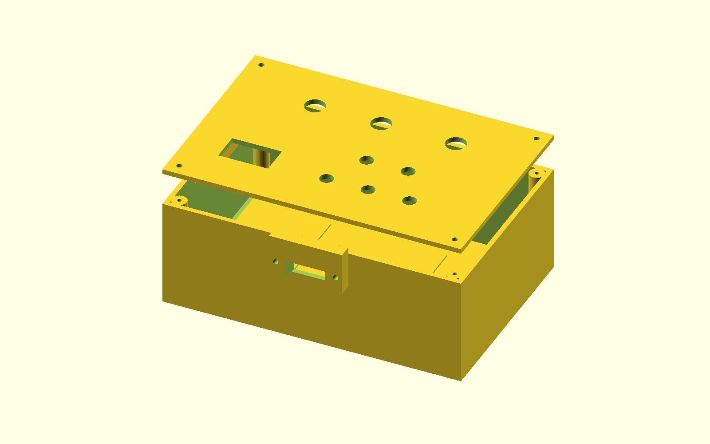
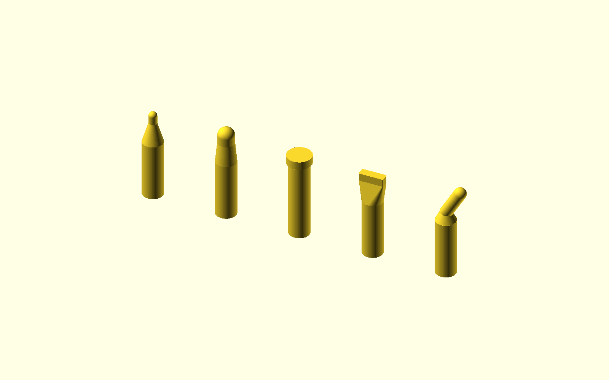

# Mechanical source, native exports and fit boundary

The current module implementation is a guarded bench instrument. The slim handheld image remains an industrial-design objective. Version 0.5.0 adds real native OpenSCAD exports, a carrier-aligned controller enclosure and corrected brass-end shape geometry.



## Controller housing

[bench_enclosure.scad](../mechanical/bench_enclosure.scad) defines a **180 x 120 x 65 mm** base with 3 mm walls/floor, a 3 mm removable lid, four PCB standoffs, four lid posts, three control openings, five preset openings, OLED window/adapter rails and a split harness-clamp model. [assembly_parameters.json](../mechanical/assembly_parameters.json) records coordinates, proposed screws and scope.

The 160 x 100 carrier sits at enclosure (10,10,9) mm. Its four mounting coordinates translate exactly to (15,15), (165,15), (15,105), (165,105) mm. That coordinate arithmetic is checked; physical fit, screw strength, wiring clearance and material performance remain untested.

| Native mesh | Intended use |
|---|---|
| [controller-base.stl](../mechanical/exports/controller-base.stl) | Controller-only fit model |
| [controller-lid.stl](../mechanical/exports/controller-lid.stl) | Panel/adapter fit model; rails face into housing |
| [harness-clamp.stl](../mechanical/exports/harness-clamp.stl) | Split cover; add a suitable insulating grommet and test retention |
| [carrier-board-only.step](../mechanical/exports/carrier-board-only.step) | Native KiCad bare board and holes; no component models |

The enclosure does **not** contain the heater, brass end, battery, charger, power switch stage, relay or RTD boards. Those stay on the guarded external bench fixture. Mounting them into this housing without a new layout and heat/wiring analysis is not a documented complete assembly.

Panel bores are 8.2 mm for five preset switches and 12.2 mm for ARM/HEAT/COOL. Select exact contact-rated switches to those interfaces or change the CAD. COOL requires two independent poles and the prescribed NC/NO functions; a visually matching single-pole button cannot substitute. Exact switch procurement and physical fit are open. The 30 x 18 mm OLED opening has adjustable rails; an adapter must be matched to the purchased current Adafruit 326 revision. No guessed OEM mounting-hole coordinates are represented as verified.

The STL lid is translated so its lowest rail surface is at Z=0 for export. In assembly, its outer top surface sits above the base rim; flip/orient in the slicer as appropriate, and account for supports. Threaded pilot posts are for fit trials. Use of inserts, material, torque, repeated assembly and cable clamps requires mechanical qualification. No ingress, flame, impact or reprocessing rating is established for a printed shell.

## Brass contact-end shapes

[tips.scad](../mechanical/tips.scad) exports one closed solid per nominal contact end. The earlier model's small spheres were partly obscured by its wider stem; the new T01/T02 have an explicit taper and projecting rounded end.



| ID | Nominal end | Native source geometry |
|---|---|---|
| T01 | 2 mm rounded | 5 mm stem, 5 mm taper, 2 mm neck, 1 mm radius dome; overall approx. 22 mm |
| T02 | 4 mm rounded | 5 mm stem, taper, 4 mm neck, 2 mm radius dome; overall approx. 23 mm |
| T03 | 6 mm disc | 5 mm stem and 6 x 2 mm disc; overall 21 mm |
| T04 | 6 x 2 mm line envelope | Blended transition to rounded plate; overall 21 mm |
| T05 | 3 mm angled | 3 mm neck at 30 degrees with rounded end; height approx. 23.56 mm |

STLs [T01](../mechanical/exports/T01-shape.stl), [T02](../mechanical/exports/T02-shape.stl), [T03](../mechanical/exports/T03-shape.stl), [T04](../mechanical/exports/T04-shape.stl), [T05](../mechanical/exports/T05-shape.stl) are **contact-end shape studies**. They contain no qualified heater/sensor construction, lock, insulation, seals, manufacturing tolerances or surface-finish release. They cannot serve as finished medical cartridge drawings. Only T01/T02 have firmware identity codes. T03-T05 remain unsupported. Shape dimensions do not specify lesion depth, contact time or an approved clinical use.

## Native checks and reproduction

[mechanical-checks.json](records/mechanical-checks.json) records OpenSCAD 2021.01 compilation, mesh triangles, bounding boxes, closed-edge incidence, input/output SHA-256 and mounting arithmetic. Eight individual meshes passed. Closed meshes do not prove strength, printable tolerances, material compatibility or thermal performance.

```sh
python tools/export_mechanical.py --openscad openscad
```

Use an absolute executable path if needed. See the [cartridge specification](cartridge-specification.md) and [engineering handover](engineering-handover.md) for construction and qualification still needed.
