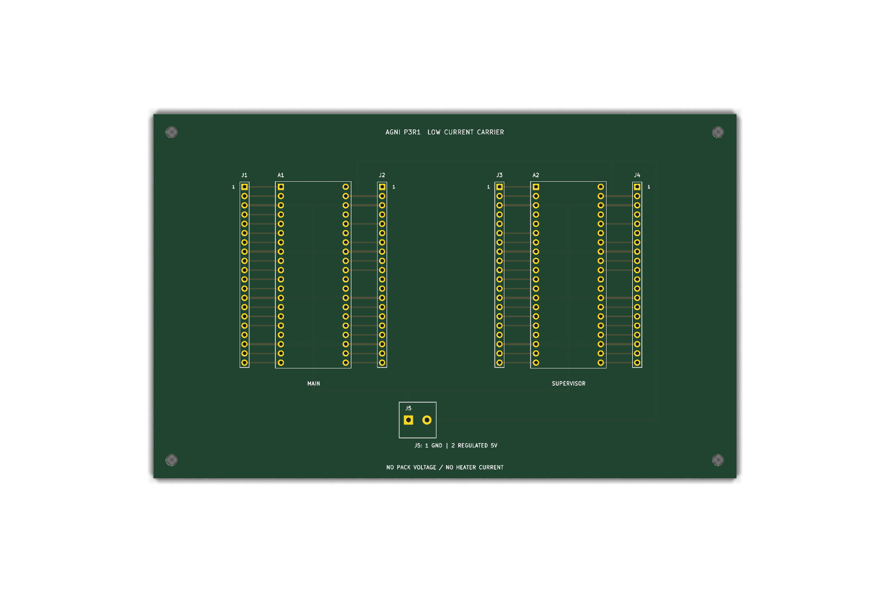

# P3R1 carrier: routed native CAD and candidate fabrication data

Version 0.5.0 adds a real routed two-layer **low-current breakout carrier**, a matched schematic, project-local symbol/footprint libraries and native KiCad 10.0.8 outputs. It is a carrier for the two Pico modules. The external power stage, relay, gate driver, sensor interfaces, ADC dividers, switch branch resistors and interlocks are still required exactly as defined in the full electrical records.



This is a native rendering of the supplied PCB geometry, without installed components. It is not an AI image, a manufactured board photograph or an assembled medical device.

## Files and measured tool results

| Deliverable | Location |
|---|---|
| Carrier project / schematic / routed board | [hardware/kicad](../hardware/kicad/README.md) |
| Portable libraries | `hardware/kicad/AGNI.kicad_sym`, `AGNI.pretty`, `sym-lib-table`, `fp-lib-table` |
| Carrier assembly BOM | [carrier_BOM.csv](../hardware/carrier_BOM.csv) |
| Every breakout pin versus physical Pico pin | [carrier_connectors.csv](../hardware/carrier_connectors.csv) |
| Full-system module/terminal schematic PDF | [module-system-schematic.pdf](../hardware/drawings/module-system-schematic.pdf) |
| Matched carrier schematic PDF | [carrier-schematic.pdf](../hardware/drawings/carrier-schematic.pdf) |
| Copper/silk/outline plots | [carrier-layers.pdf](../hardware/drawings/carrier-layers.pdf), [routing SVG](images/carrier-routing.svg) |
| Native check records and source hashes | [native-cad-checks.json](records/native-cad-checks.json) |
| Candidate Gerbers/drills and fabrication instructions | [P3R1 fabrication folder](../hardware/fabrication/P3R1/README.md) |
| Board-only mechanical export | [carrier-board-only.step](../mechanical/exports/carrier-board-only.step) |

Recorded native results: carrier ERC 0 findings; full module-system ERC 0 findings; carrier DRC 0 findings; unconnected items 0; schematic-to-PCB parity issues 0. The raw reports list the tool's default ignored categories. No findings were hidden by adding exclusions to obtain these counts.

The symbols are generic **passive terminal blocks**. ERC checks their connectivity and syntax, but does not verify real power/signal pin directions or the manufacturer-controlled circuits inside bought modules. The full system schematic and carrier schematic serve different scopes. A clean carrier DRC does not verify the external heater switching circuit.

## Physical definition

- 160 x 100 mm rectangular board, nominal thickness 1.6 mm, two copper layers.
- 0.35 mm signal tracks, 0.60 mm low-current supply/ground tracks; declared 0.20 mm clearance and 0.50 mm copper-to-edge minimum. No claim of heater-current capacity.
- A1 MAIN left row at board X=35 mm; A2 SUPERVISOR left row X=105 mm. Each top header row Y=20 mm. Pico rows are 17.78 mm apart, 2.54 mm longitudinal pitch.
- All eight ground pins per Pico join GND. The two 3V3 outputs are separate nets.
- Four 20-pin breakout strips J1..J4 sit adjacent to their corresponding Pico rows. **All breakout strips number from the top, 1 to 20.** The Pico's right-side physical pins run in the opposite numerical direction: J2/J4 pin 1 corresponds to Pico physical pin 40. Refer to the CSV for each signal. NC pads are isolated, including Pico VBUS, RUN and 3V3_EN; do not use them as spare power points.
- J5 pin 1 is GND, pin 2 is **regulated 5 V**. It is never a 2S pack or heater-power inlet. J5 uses 1.3 mm holes; all header holes are 1.0 mm.
- Four non-plated mounting holes: diameter 3.2 mm at (5,5), (155,5), (5,95), (155,95) mm from the upper-left board corner.
- The STEP export contains the board and holes. No real component-height/interference model is included.

## Assembly sequence

1. Independently compare the drawings, connector CSV, manufacturer module drawings and actual purchased parts. Print a 1:1 template and check the parts against it before ordering boards.
2. Have the PCB fabricator review the candidate CAM files, stack, drill and annular-ring capability. Review mask openings, outline, hole alignment, scale and layer count in its CAM viewer. This review has not been performed here.
3. Populate J5, four breakout headers and four 20-contact socket strips. Use two socket strips per Pico and a temporary unpowered alignment fixture while soldering. Keep solder bridges out of adjacent pads.
4. With **no Pico modules, battery or external power stage attached**, inspect joints and measure continuity against the connector table. Check J5 polarity and isolation of the two 3V3 nets and unused pads. There is no polarity protection on this passive board.
5. Apply a guarded current-limited regulated logic supply. Check voltages, switch off, then fit the Pico modules in the indicated orientation. Check orientation against physical pin 1 and the manufacturer pinout; a rotated Pico can be damaged.
6. Add the external branches, sensor interfaces, controls and full power circuit using BUILD_GUIDE. The carrier does not replace those circuits. Keep high-current returns out of these headers.
7. Complete target-board, fault, electrical and thermal tests before considering integration into a portable enclosure.

## Reproduction

Install KiCad 10.0.8 (or independently validate a newer version). From the repository root:

```sh
python -m tools.generate_carrier
python tools/native_cad.py --kicad-cli kicad-cli --render
python tools/verify.py
```

Supply an absolute executable path to `--kicad-cli` if it is not on PATH. Regenerating CAD invalidates existing recorded source hashes until native checks are rerun. `tools/regenerate_engineering.py` now calls the routed-carrier generator and does not restore the old unrouted starter.

Text sources/exports use LF line endings and `.gitattributes` enforces that for Git checkouts. `python tools/text_format.py` restores canonical line endings after a Windows editor change. Native exporters canonicalize their own text inputs/outputs before recording SHA-256. Re-run evidence generation after substantive edits.

Primary tool reference: [KiCad 10 CLI manual](https://docs.kicad.org/10.0/en/cli/cli.html). See [handover](engineering-handover.md) for the remaining product work.
